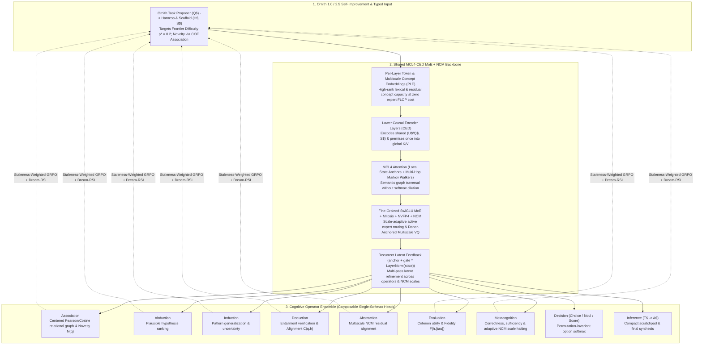

# MCL4-COE (`ncm`): Markov Chain Local-4, Cognitive Operator Ensemble & Next-Concept Modeling

**`MCL4-COE`** is a cognitive architecture combining **multi-hop sparse Markov-chain graph attention (`MCL4`)**, a **Causal Encoder-Decoder (`CED`) MoE backbone**, a **Composable Cognitive Operator Ensemble (`COE`)** that decomposes reasoning into explicit single-softmax latent operations, **Donor-Anchored Next-Concept Modeling (`NCM`)** ([Kumbong et al., `arXiv:2610.14162`](https://arxiv.org/abs/2610.14162)), and **Windowless Infinite-Context Inference + Inference-Time Learning (`InfiniteContextPager` & `CodebaseWarmupEngine`)**.

Instead of forcing a monolithic dense transformer to serialize every thought, correlation, and decision into hundreds of English tokens through a 150,000-word vocabulary softmax, `MCL4-COE` executes reasoning operations (`Association`, `Decision`, `Deduction`, `Abduction`, `Induction`, `Evaluation`, `Abstraction`, `Metacognition`) as **composable single-softmax heads** directly over shared encoder-decoder and multiscale `NCM` concept latents.

---

## Pretrained Checkpoints on Hugging Face (`Safetensors`)

| Checkpoint | Base Donor & Topology | Total Params | NCM Hierarchy | Hugging Face Repository |
| :--- | :--- | :---: | :--- | :--- |
| **`MCL4-COE-v9-Llama-3.2-1B-NCM-Mitosis-R2`** (`Step 10,000`) | `unsloth/Llama-3.2-1B-Instruct` (`meta-llama/Llama-3.2-1B-Instruct`) split into `8+8` `CED` layers, Sliced-Dense upcycled via 2 rounds of NVFP4 MoE Mitosis (`E=8 -> 12 -> 16, top_k=8`) + 9-Operator `COE` | `2.43B` (`2,430,634,929`) | `4` levels ($\ell_k \in [1, 8, 29, 64]$, $V_k = 1024$, `73.8%` codebook util) | **[`mesmac/MCL4-COE-v9-Llama-3.2-1B-NCM-Mitosis-R2`](https://huggingface.co/mesmac/MCL4-COE-v9-Llama-3.2-1B-NCM-Mitosis-R2)** |
| **`MCL4-COE-v7-Granite-3.1-1B-NCM-MoE`** (`Step 9,000`) | `ibm-granite/granite-3.1-1b-a400m-instruct` grafted into `12+12` `CED` layers and mitotically expanded from `E=32 -> 40, top_k=8` NVFP4 + 9-Operator `COE` | `1.77B` (`1,773,191,615`) | `6` levels ($\ell_k \in [1, 4, 11, 24, 41, 64]$, $V_k = 1024$, `77.8%` codebook util) | **[`mesmac/MCL4-COE-v7-Granite-3.1-1B-NCM-MoE`](https://huggingface.co/mesmac/MCL4-COE-v7-Granite-3.1-1B-NCM-MoE)** |

### Quickstart: Loading Checkpoints from Hugging Face

```bash
pip install safetensors huggingface_hub "git+https://github.com/mESmaC/mcl4-coe-ncm.git"
```

```python
import torch
from mcl4_coe import load_pretrained_mcl4_coe_ncm

model = load_pretrained_mcl4_coe_ncm(
    "mesmac/MCL4-COE-v9-Llama-3.2-1B-NCM-Mitosis-R2",
    device="cuda" if torch.cuda.is_available() else "cpu",
    dtype="bfloat16",
)
print("Loaded MoE experts:", model.backbone.config.num_experts, "| NCM levels:", model.ncm_system.levels)
```

---

## Key Empirical Results on This Branch (`ncm`)

### 1. Grafting Next-Concept Modeling (`NCM`) + Single-Softmax `COE` onto Pretrained Donors (`Llama-3.2-1B` & `Granite 3.1`)
* **Implementation & Full Technical Spec:** [`src/mcl4_coe/ncm.py`](src/mcl4_coe/ncm.py) | [`docs/10_NCM_MCL4_COE_ARCHITECTURE_MAPPING.md`](docs/10_NCM_MCL4_COE_ARCHITECTURE_MAPPING.md)
* **Run Artifacts & JSON Benchmarks:** [`runs/colab_mcl4_coe_v9_llama32_1b_dense_ncm_rl/`](runs/colab_mcl4_coe_v9_llama32_1b_dense_ncm_rl/) ([`Step 4,000`](runs/colab_mcl4_coe_v9_llama32_1b_dense_ncm_rl/benchmark_step_04000_vs_llama32_1b.json), [`Step 6,000`](runs/colab_mcl4_coe_v9_llama32_1b_dense_ncm_rl/benchmark_step_06000_vs_llama32_1b.json), and [`Step 10,000 Mitosis Round 2`](runs/colab_mcl4_coe_v9_llama32_1b_dense_ncm_rl/benchmark_step_10000_mitosis_r2_vs_llama32_1b.json))

In standalone NCM (`arXiv:2610.14162`), sampling all $\ell_k$ positions in parallel within scale $k$ requires generating $M = 16\text{–}256$ complete full-length candidates and running post-hoc Minimum Bayes Risk (MBR) over decoded strings.

By grafting a frozen-donor Multiscale Residual VQ-VAE (`DonorAnchoredMultiscaleVQVAE`) and `NCMGeneratorAdapter` onto `unsloth/Llama-3.2-1B-Instruct` (Sliced-Dense upcycled to `E=8` at Step 0, trained with mandatory multi-operator `COE` conditioning through Step 6,000, and expanded via **2 rounds of NVFP4 MoE Mitosis** to `E=16, top_k=8` at Step 10,000 across 64 verifiable RLVR skill families + `Dream-RSI`), intermediate coarse-to-fine reconstructions $\hat{z}^{(k)}$ supervise the 9 single-softmax `COE` operators directly in latent space.

#### External 12-Suite Benchmark Progression (`v9 Llama-3.2-1B-Dense -> NCM + Mitotic MoE + COE`)

The table below reports every benchmark from [`benchmark_step_06000_vs_llama32_1b.json`](runs/colab_mcl4_coe_v9_llama32_1b_dense_ncm_rl/benchmark_step_06000_vs_llama32_1b.json) and [`benchmark_step_10000_mitosis_r2_vs_llama32_1b.json`](runs/colab_mcl4_coe_v9_llama32_1b_dense_ncm_rl/benchmark_step_10000_mitosis_r2_vs_llama32_1b.json) across both mitotic clone-scale calibration profiles (`Profile A: r1=0.30, r2=1.00, ad=0.05` and `Profile B: r1=0.30, r2=0.45, ad=0.05`), comparing standard token-likelihood (`acc_norm`) against the single-softmax **`COE` Decision head (`coe_decision_acc`)**:

| Benchmark Suite | Raw BF16 `Llama-3.2-1B-Instruct` (`acc_norm`) | `Step 6,000` (`E=8`) `acc_norm` $\to$ **`coe_decision_acc`** | `Step 10,000` (`E=16`, Profile A `r2=1.00`) `acc_norm` $\to$ **`coe_decision_acc`** | `Step 10,000` (`E=16`, Profile B `r2=0.45`) `acc_norm` $\to$ **`coe_decision_acc`** | Peak `COE` Gain vs. Base Donor |
| :--- | :---: | :---: | :---: | :---: | :---: |
| **OpenBookQA MultiHop** (`N=500`, 4-way) | `37.20%` | `36.60%` $\to$ **`56.20%`** | `38.20%` $\to$ **`58.40%`** (`+20.20`) | `37.80%` $\to$ **`59.80%`** (`+22.00`) | **`+22.60 pts`** |
| **ARC-Challenge** (`N=300`, 4-way) | `32.00%` | `33.33%` $\to$ **`45.67%`** | `33.67%` $\to$ **`49.00%`** (`+15.33`) | `32.00%` $\to$ **`46.67%`** (`+14.67`) | **`+17.00 pts`** |
| **MMLU 57-Subject** (`N=342`, 4-way) | `35.38%` | `33.33%` $\to$ **`47.08%`** | `37.13%` $\to$ **`44.15%`** *(Adaptive: `45.91%`)* | `35.67%` $\to$ **`47.37%`** (`+11.70`) | **`+11.99 pts`** |
| **MuSR Object Placements** (`N=256`, 5-way) | `25.00%` | `23.83%` $\to$ **`32.81%`** | `26.95%` $\to$ **`33.98%`** *(Multi-Op: `34.38%`)* | `25.39%` $\to$ **`33.20%`** *(Adaptive: `34.38%`)* | **`+9.38 pts`** |
| **BBH Logical Deduction 5-Obj** (`N=250`, 5-way) | `22.80%` | `26.00%` $\to$ **`29.60%`** | `26.40%` $\to$ **`26.80%`** *(Multi-Op: `28.40%`)* | `26.40%` $\to$ **`26.40%`** *(Adaptive: `26.80%`)* | **`+6.80 pts`** |
| **BBH Tracking Shuffled Obj** (`N=250`, 3-way) | `31.60%` | `35.20%` $\to$ **`34.40%`** | `34.40%` $\to$ **`34.80%`** *(Adaptive: `35.60%`)* | `32.00%` $\to$ **`30.80%`** | **`+4.00 pts`** |
| **BBH Logical Deduction 3-Obj** (`N=250`, 3-way) | `38.00%` | `37.60%` $\to$ **`37.60%`** | `38.00%` $\to$ **`41.20%`** (`+3.20`) | `39.20%` $\to$ **`37.60%`** | **`+3.20 pts`** |
| **MuSR Murder Mysteries** (`N=250`, 2-way) | `52.80%` | `52.40%` $\to$ **`53.60%`** | `52.00%` $\to$ **`54.80%`** (`+2.80`) | `52.00%` $\to$ **`52.80%`** (`+0.80`) | **`+2.00 pts`** |
| **BBH Web of Lies** (`N=250`, 2-way) | `50.00%` | `52.40%` $\to$ **`51.60%`** *(Adaptive: `54.80%`)* | `47.20%` $\to$ **`48.00%`** | `49.60%` $\to$ **`51.20%`** (`+1.60`) | **`+4.80 pts`** |
| **MuSR Team Allocation** (`N=250`, 3-way) | `39.20%` | `38.00%` $\to$ **`36.00%`** | `32.00%` $\to$ **`34.80%`** (`+2.80`) | `32.40%` $\to$ **`38.00%`** (`+5.60`) | `-1.20 pts` (`+5.60` vs. Step 10k LM) |
| **BBH Formal Fallacies** (`N=250`, 2-way) | `46.80%` | `46.80%` $\to$ **`47.60%`** | `46.80%` $\to$ **`46.80%`** | `46.80%` $\to$ **`46.80%`** | **`+0.80 pts`** |
| **HellaSwag** (`N=300`, 4-way) | `50.67%` | `50.67%` $\to$ `40.67%` | `51.67%` (`acc_norm`) / `45.00%` (`coe`) | `49.67%` (`acc_norm`) / `45.33%` (`coe_adaptive`) | **`+1.00 pt`** (`acc_norm`) |

* **Frontier Agentic Benchmarks at Step 10,000 ([`benchmark_step_10000_mitosis_r2_vs_llama32_1b.json`](runs/colab_mcl4_coe_v9_llama32_1b_dense_ncm_rl/benchmark_step_10000_mitosis_r2_vs_llama32_1b.json)):**
  * **Terminal-Bench 2.1 (`N=89`, 4-way):** `33.71%` Solution Synthesis (`acc_norm`), `32.58%` Verification Suite (`acc`), and on the **Hard Split (`N=30`)** single-softmax `COE` jumps from `26.67%` (`acc_norm`) $\to$ **`36.67%`** (`coe_decision_acc`, **`+10.00 pts`**; `60.0%` on debugging, `50.0%` `coe_adaptive_acc` on scientific computing).
  * **Agents' Last Exam v1.1 (`N=122`, 4-way):** **`51.64%`** Workflow All (`acc`; `58.54%` Full-Spectrum split, `51.11%` Near-Term split, `47.22%` Last-Exam split).

#### Numerical Stabilization Fixes for Donor-Anchored NCM Training ([`src/mcl4_coe/ncm.py`](src/mcl4_coe/ncm.py))
1. **Scale-Normalized Dead-Code Restart (`MultiscaleResidualQuantizer._restart_dead_codes`):**
   Because level $k$ processes $B \cdot \ell_k$ tokens per step across $\ell_k \in \{1, 4, 9, 16, \dots, L\}$, the stationary average cluster count $\bar{c}_k \approx (B \cdot \ell_k) / V_k$ varies by up to $256\times$ across scales, and resetting `ema_w[dead] = new_vecs` without scaling by the cluster count causes a $20\times$ codebook norm inflation (`||E||_2: 0.7 -> 19.6`). Normalizing both dead-code detection `(ema_cs / mean_cs) < restart_threshold` and the reset state `ema_cs[dead] = mean_cs`, `ema_w[dead] = new_vecs * mean_cs` makes restarts scale-invariant across all coarse-to-fine levels—achieving **`62.92%` active codebook utilization** at Step 5,500 and **`77.78%` active codebook utilization** by Step 9,000 on `Granite 3.1` (`73.83%` at Step 10,000 on `Llama-3.2-1B`, peaking at `82.10%` at Step 6,000).
2. **Codebook-RMS Query Normalization (`TiedCodebookHead.forward`):**
   Normalizing projected decoder queries $u$ to match each level's codebook RMS $\sqrt{\overline{\lVert E_k \rVert_2^2} / d_{\mathrm{vq}}}$ prevents squared-distance logits $-d(u, E_k) / \overline{\lVert E_k \rVert_2^2}$ from exploding at Step 1 (dropping initial Step-1 generator CE from **`51.44` $\to$ `7.59`**).
3. **Scale-Interpolated Positional Embeddings & Prompt Cross-Attention (`NCMGeneratorAdapter`):**
   Interpolating positional embeddings across $\ell_k \in [1, 4, 11, 24, 41, 64]$ with point-wise prompt cross-attention produces an emergent coarse-to-fine semantic hierarchy (`84.4%` mean / `89.5%` peak exact token recovery at Step 5,500 and **`85.35%` at Step 9,000**, with quantization misses decoding to nearest semantic synonyms in frozen donor embedding space).

---

### 2. `MCL4-JIT`: Online GRPO RL on a 180B NVFP4 MoE (`Qwen3.8-Flash-Next-NVFP4`) in `38.02 GiB` VRAM
* **Implementation & Verification Report:** [`src/mcl4_coe/qwen_jit.py`](src/mcl4_coe/qwen_jit.py) | [`runs/mcl4_jit_qwen38_nvfp4/mcl4_jit_blackwell_verification.json`](runs/mcl4_jit_qwen38_nvfp4/mcl4_jit_blackwell_verification.json)

`MCL4-JIT` enables online reinforcement learning (`GRPO`, $G=8$) and mitotic expert adaptation on **`nvidia/Qwen3.8-Flash-Next-NVFP4` (`180B` parameters, 48 layers, 24,576 routed experts)** on a single Blackwell GPU (`SM120` native `F.scaled_mm float4_e2m1fn_x2`) within **`38.02 GiB` peak VRAM**:
* **`mmap`-to-GPU Working-Set Expert Paging:** Streams `2.64 MiB` NVFP4 expert shards in **`340.4 µs`** (`7.76 GB/s`), achieving a **`99.6%` warm working-set cache hit rate** while holding 8,486 active experts in **`21.85 GiB` VRAM**.
* **Amortized 47-Layer Stem + Plastic Mitotic Graft:** Emits the 47-layer stem once (`7.40s`) and updates a `78.49 MiB` (`41.15M` parameter) plastic top-layer mitotic graft in **`156.21 ms`** (`1,638.8 tok/s`), achieving **`1.08s` per amortized GRPO step** (**`0.3 hours` per 1,000 RL updates**).
* **Native Blackwell `float4_e2m1fn_x2` Mitotic Binary Recompiler:** Recompiles trained plastic clones directly back into hardware-native NVFP4 format in **`2.41 ms/expert`** with **`0.998914` weight cosine similarity** and **`0.994533` full-vocabulary logit cosine similarity** (`91.41%` top-1 token agreement, zero full-model requantization).

---

### 3. Effectively Infinite Context Window Inference & Inference-Time Learning (`src/mcl4_coe/context_memory.py`)
* **Implementation & Full Technical Spec:** [`src/mcl4_coe/context_memory.py`](src/mcl4_coe/context_memory.py) | [`docs/CONTEXT_HIERARCHY_AND_PUBLICATION_ROADMAP.md`](docs/CONTEXT_HIERARCHY_AND_PUBLICATION_ROADMAP.md)

Standard transformers degrade on long contexts for two reasons: RoPE positional indices drift out of distribution past the training window, and dense $O(T^2)$ attention dilutes softmax mass across thousands of irrelevant tokens. `MCL4-COE` solves both while enabling fast inference-time learning on unseen repositories:

1. **Windowless Demand-Paged Context (`InfiniteContextPager` & `WorkingStateLedger`, $1\text{M} \to \infty$ Effective Context):**
   * **Local-RoPE `TurboQuant` Page Ingestion:** Arbitrarily long token streams are sliced into `page_size = 512` pages, encoded with **local RoPE `[0 .. page_size]`** (so positional embeddings never go out of distribution), summarized into `G = 4` multi-resolution landmarks, and compressed **`~4.2x`** via `TurboQuantKV` (`FWHT` + 3-bit Lloyd-Max + 1-bit `QJL` residual sign sketch) with SHA-256 content deduplication.
   * **Zero-Forgetting Pinned `WorkingStateLedger` (`CED` `n_prefix` Slot 0):** Permanently pins the active `[OBJECTIVE]`, `[STEP]`, and verified `[INVARIANTS]` in `CED` `n_prefix` slot 0 so the model physically cannot forget its goal across millions of ingested tokens.
   * **Vectorized `QJL` Inner-Product Retrieval into Position-Invariant `CED` Cross-Attention:** `retrieve_top_k_pages` scores thousands of compressed pages directly in rotated `TurboQuant` space (`turboquant_inner_product`) and decompresses **only the `top-B` relevant pages** alongside the pinned `WorkingStateLedger` into position-invariant `CED` cross-attention (`build_gist_state`).
2. **Inference-Time Learning (`CodebaseWarmupEngine`, Dirty-Page Micro-Warmup & Zero-Weight `A.TXY` WAL):**
   * **Pre-Prompt Session RL Warmup (`CodebaseWarmupEngine.warmup_session`):** When pointed at a new codebase at inference time, `index_repository` compiles the repository AST into the base-36 `ATXYPageStore` (`1,679,616` logical cells across Planes `A0..A5`) and automatically synthesizes AST-verified self-RL tasks (**Symbol & Call-Graph Localization** + **Real-vs-Mutated Code Bug Discrimination**). `warmup_session` freezes `coe.backbone` (preserving 100% of generation fluency), pre-caches the frozen backbone states once, and runs 24+ multi-operator RL updates on the lightweight `COE` operator and `AttentiveMatchedFilterPool` heads (`~600K` params) in **`~1–2 seconds`** (reversible in `<1 ms` via `session.restore_base_weights(coe)`).
   * **Incremental Dirty-Page Refresh (`refresh_dirty_files`):** When files are modified mid-session, only the dirty AST symbols and `TurboQuant` pages are re-indexed, appended to the framed CRC32 Write-Ahead Log (`WAL`), and micro-adapted in milliseconds.

---

## Core Architecture Overview

1. **Markov Chain Local-4 Attention (`MCL4`, [`src/mcl4_coe/markov_local4.py`](src/mcl4_coe/markov_local4.py)):**
   Eliminates dense attention's all-to-all softmax dilution by locking local state anchors and routing bounded multi-hop Markov transitions across the semantic graph (`markov_steps=3, markov_graph_degree=4, markov_num_walkers=4`).
   * **Controlled 1.1M TinyStories Ablation (`mcattn`):** Reserving **4 local anchor positions + 12 Markov-walked positions** (`16` tokens attended out of `256`) achieved **`1.1832` nats/byte** (`1.1870 ± 0.0002` sampled) vs. **`1.2189` nats/byte** for standard dense 256-token attention on matched initial weights and batches.
   * **Donor-Grafted `v7` & `v9` Checkpoints (`512` context):** Configured with **`markov_local_tokens=8` local anchors + `16` Markov-walked positions (`markov_attend_tokens=24` attended tokens total)**.
2. **Causal Encoder-Decoder (`CED`) Shared-State Cross-Attention ([`src/mcl4_coe/backbone.py`](src/mcl4_coe/backbone.py)):**
   Encodes shared context/premises once in lower causal layers into global `K/V`, and cross-attends each candidate option independently in upper decoder layers before pooling into a zero-parameter Pearson cosine softmax—breaking the `44.4%` bi-encoder relational binding ceiling to **`100.0%`** while preserving **100% bitwise candidate permutation invariance**.
3. **Cognitive Operator Ensemble (`COE`, [`src/mcl4_coe/operators.py`](src/mcl4_coe/operators.py)):**
   Decomposes reasoning into 9 composable single-softmax operators (`Association`, `Decision`, `Evaluation`, `Deduction`, `Induction`, `Abduction`, `Abstraction`, `Metacognition`, and `Inference`) chained via `RecurrentFeedback`.



---

## Documentation Index

| Document | Summary |
| :--- | :--- |
| **[`docs/10_NCM_MCL4_COE_ARCHITECTURE_MAPPING.md`](docs/10_NCM_MCL4_COE_ARCHITECTURE_MAPPING.md)** | **NCM + `MCL4-COE` Integration & Empirical Validation:** Mapping Next-Concept Modeling (`arXiv:2610.14162`) onto `MCL4-COE`, frozen-donor grafting protocol, scale-normalized dead-code restart, codebook-RMS query normalization, and `Granite 3.1` (`Step 5,500 -> 9,000`) / `Llama-3.2` (`Step 10,000`) validation results. |
| **[`docs/01_UNIFIED_ARCHITECTURE_SPEC.md`](docs/01_UNIFIED_ARCHITECTURE_SPEC.md)** | Full technical specification of the `MCL4` router, `CED` cross-attending encoder-decoder fix, `PLE`, `CPUOffloadAdamW` + `NVFP4`, and mathematical definitions of all 9 `COE` cognitive operators. |
| **[`docs/02_WHY_COE_BEATS_GENERALIST_LLMS.md`](docs/02_WHY_COE_BEATS_GENERALIST_LLMS.md)** | Architectural comparison of composable single-softmax operators (`Decision`, `Association`, `Deduction`, `Abduction`, `Metacognition`) against standard autoregressive token-softmax LLMs. |
| **[`docs/03_HARDWARE_AND_TRAINING_ROADMAP.md`](docs/03_HARDWARE_AND_TRAINING_ROADMAP.md)** | Consumer GPU memory-hierarchy engineering (`sm_86` $\to$ Blackwell `sm_120`), native `NVFP4` execution, staged curriculum, and repository module map. |
| **[`docs/CONTEXT_HIERARCHY_AND_PUBLICATION_ROADMAP.md`](docs/CONTEXT_HIERARCHY_AND_PUBLICATION_ROADMAP.md)** | **Infinite-Context Inference & Inference-Time Learning:** `InfiniteContextPager` + `WorkingStateLedger` ($1\text{M}\to\infty$ windowless paging), `TurboQuantKV`, `ContextLMCompressor`, `A.TXY` base-36 virtual memory, and `CodebaseWarmupEngine` fast-weight session RL. |
| **[`docs/05_ORNITH_SELF_SCAFFOLDING_SPEC.md`](docs/05_ORNITH_SELF_SCAFFOLDING_SPEC.md)** | Specification of **Ornith-1.0** (`U$ -> S$ -> T$ -> A$` self-scaffolding) and **Ornith-1.5 / 2.5** (`Q$ -> H$/S$ -> T$/A$` autonomous self-improvement powered by `COE` operators). |
| **[`docs/06_V4_PRETRAIN_AND_PURE_RL_RSI_RESULTS.md`](docs/06_V4_PRETRAIN_AND_PURE_RL_RSI_RESULTS.md)** | From-scratch `v4` pretraining (`Step 1 -> 6,000`) and pure self-improvement RL + `Dream-RSI` (`Step 6,001 -> 7,000`) ablations with exact-ratio twin-gated mitosis. |
| **[`docs/07_PROPER_DONOR_RL_MITOSIS_PROTOCOL.md`](docs/07_PROPER_DONOR_RL_MITOSIS_PROTOCOL.md)** | Donor-anchored RL/RSI mitotic expert splitting protocol and post-mortem comparison (`Granite 3.1` vs. `OLMoE`). |
| **[`docs/08_NVFP4_GROUPED_MOE_RL_HANDOFF.md`](docs/08_NVFP4_GROUPED_MOE_RL_HANDOFF.md)** | Native Blackwell `NVFP4` fused multi-expert grouped MoE kernel (`nvfp4_grouped_linear`) and pure-RL validation. |
| **[`docs/09_STEP5000_BENCHMARKS_AND_PP_ORNITH_HANDOFF.md`](docs/09_STEP5000_BENCHMARKS_AND_PP_ORNITH_HANDOFF.md)** | Batched `Dream-RSI` tree discovery acceleration, performance-point (`pp = p * 0.95^(n-1)`) curriculum weighting, and `Step 5,000` Granite 3.1 benchmarks. |
