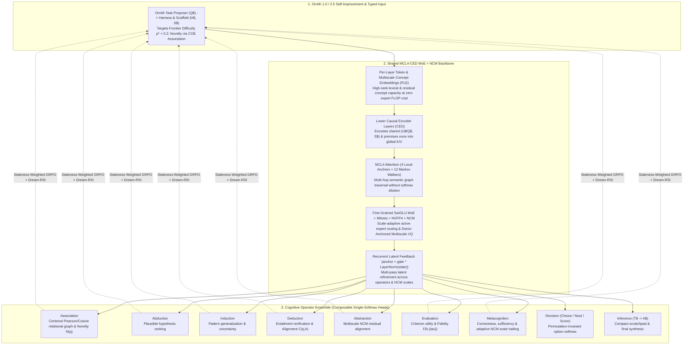

# MCL4-COE (`ncm`): Markov Chain Local-4, Cognitive Operator Ensemble & Next-Concept Modeling

**`MCL4-COE`** is a cognitive architecture Combining **multi-hop sparse Markov-chain graph attention (`MCL4`)**, a **Causal Encoder-Decoder (`CED`) MoE backbone**, a **Composable Cognitive Operator Ensemble (`COE`)** that decomposes reasoning into explicit single-softmax latent operations, and **Donor-Anchored Next-Concept Modeling (`NCM`)** ([Kumbong et al., `arXiv:2610.14162`](https://arxiv.org/abs/2610.14162)).

Instead of forcing a monolithic dense transformer to serialize every thought, correlation, and decision into hundreds of English tokens through a 150,000-word vocabulary softmax, `MCL4-COE` executes reasoning operations (`Association`, `Decision`, `Deduction`, `Abduction`, `Induction`, `Evaluation`, `Abstraction`, `Metacognition`) as **composable single-softmax heads** directly over shared encoder-decoder and multiscale `NCM` concept latents.

---

## Pretrained Checkpoints on Hugging Face (`Safetensors`)

| Checkpoint | Base Donor & Topology | NCM Hierarchy | Hugging Face Repository |
| :--- | :--- | :--- | :--- |
| **`MCL4-COE-v9-Llama-3.2-1B-NCM-Mitosis-R2`** (`Step 10,000`) | `meta-llama/Llama-3.2-1B` upcycled via 2 rounds of Sliced-Dense NVFP4 MoE Mitosis (`E=16, top_k=8`) + 9-Operator `COE` | `4` levels ($\ell_k \in [1, 8, 29, 64]$, $V_k = 1024$) | **[`mesmac/MCL4-COE-v9-Llama-3.2-1B-NCM-Mitosis-R2`](https://huggingface.co/mesmac/MCL4-COE-v9-Llama-3.2-1B-NCM-Mitosis-R2)** |
| **`MCL4-COE-v7-Granite-3.1-1B-NCM-MoE`** (`Step 9,000`) | `ibm-granite/granite-3.1-1b-a400m-instruct` (`E=40, top_k=8` NVFP4) + 9-Operator `COE` | `6` levels ($\ell_k \in [1, 4, 11, 24, 41, 64]$, $V_k = 1024$) | **[`mesmac/MCL4-COE-v7-Granite-3.1-1B-NCM-MoE`](https://huggingface.co/mesmac/MCL4-COE-v7-Granite-3.1-1B-NCM-MoE)** |

### Quickstart: Loading Checkpoints from Hugging Face

```bash
pip install safetensors huggingface_hub "git+https://github.com/mESmaC/mcl4-coe-ncm.git"
```

```python
import torch
from mcl4_coe import load_pretrained_mcl4_coe_ncm

model = load_pretrained_mcl4_coe_ncm(
    "mesmac/MCL4-COE-v9-Llama-3.2-1B-NCM-Mitosis-R2",
    device="cuda" if torch.cuda.is_available() else "cpu",
    dtype="bfloat16",
)
print("Loaded MoE experts:", model.backbone.config.num_experts, "| NCM levels:", model.ncm_system.levels)
```

---

## Key Empirical Results on This Branch (`ncm`)

### 1. Grafting Next-Concept Modeling (`NCM`) + Single-Softmax `COE` onto Pretrained Donors (`Llama-3.2-1B` & `Granite 3.1`)
* **Implementation & Full Technical Spec:** [`src/mcl4_coe/ncm.py`](src/mcl4_coe/ncm.py) | [`docs/10_NCM_MCL4_COE_ARCHITECTURE_MAPPING.md`](docs/10_NCM_MCL4_COE_ARCHITECTURE_MAPPING.md)
* **Run Artifacts & JSON Benchmarks:** [`runs/colab_mcl4_coe_v9_llama32_1b_dense_ncm_rl/`](runs/colab_mcl4_coe_v9_llama32_1b_dense_ncm_rl/)

In standalone NCM (`arXiv:2610.14162`), sampling all $\ell_k$ positions in parallel within scale $k$ requires generating $M = 16\text{–}256$ complete full-length candidates and running post-hoc Minimum Bayes Risk (MBR) over decoded strings.

By grafting a frozen-donor Multiscale Residual VQ-VAE (`DonorAnchoredMultiscaleVQVAE`) and `NCMGeneratorAdapter` onto `Llama-3.2-1B-Dense` (upcycled via **2 rounds of Sliced-Dense NVFP4 MoE Mitosis** to `E=16, top_k=8` across 64 verifiable RL skill families + `Dream-RSI`), intermediate coarse-to-fine reconstructions $\hat{z}^{(k)}$ supervise the 9 single-softmax `COE` operators directly in latent space.

On the **exact same Step 10,000 checkpoint** ([`benchmark_step_10000_mitosis_r2_vs_llama32_1b.json`](runs/colab_mcl4_coe_v9_llama32_1b_dense_ncm_rl/benchmark_step_10000_mitosis_r2_vs_llama32_1b.json)), evaluating via the single-softmax **`COE` Decision / Adaptive heads** vs. standard token-likelihood (`acc_norm`) on external benchmarks yields:

| Benchmark Suite | Standard LM `acc_norm` | Single-Softmax `COE` (`coe_decision_acc` / `coe_adaptive_acc`) | Delta ($\Delta$) |
| :--- | :---: | :---: | :---: |
| **OpenBookQA MultiHop Science** (`N=500`, 4-way) | `37.80%` | **`59.80%`** | **`+22.00 pts`** |
| **ARC-Challenge** (`N=300`, 4-way) | `33.67%` | **`49.00%`** | **`+15.33 pts`** |
| **MMLU 57-Subject** (`N=342`, 4-way) | `35.67%` | **`47.37%`** | **`+11.70 pts`** |
| **Terminal-Bench 2.1 Hard Split** (`N=30`, 4-way) | `26.67%` | **`36.67%`** | **`+10.00 pts`** |
| **MuSR Team Allocation** (`N=250`, 3-way) | `32.40%` | **`38.00%`** | **`+5.60 pts`** |
| **MuSR Murder Mysteries** (`N=250`, 2-way) | `52.00%` | **`54.80%`** | **`+2.80 pts`** |
| **BBH Logical Deduction 3-Obj** (`N=250`, 3-way) | `38.00%` | **`41.20%`** | **`+3.20 pts`** |

#### Numerical Stabilization Fixes for Donor-Anchored NCM Training ([`src/mcl4_coe/ncm.py`](src/mcl4_coe/ncm.py))
1. **Scale-Normalized Dead-Code Restart (`MultiscaleResidualQuantizer._restart_dead_codes`):**
   Because level $k$ processes $B \cdot \ell_k$ tokens per step across $\ell_k \in \{1, 4, 9, 16, \dots, L\}$, the stationary average cluster count $\bar{c}_k \approx (B \cdot \ell_k) / V_k$ varies by up to $256\times$ across scales, and resetting `ema_w[dead] = new_vecs` without scaling by the cluster count causes a $20\times$ codebook norm inflation (`||E||_2: 0.7 -> 19.6`). Normalizing both dead-code detection `(ema_cs / mean_cs) < restart_threshold` and the reset state `ema_cs[dead] = mean_cs`, `ema_w[dead] = new_vecs * mean_cs` makes restarts scale-invariant across all coarse-to-fine levels and achieves **`62.92%` active codebook utilization** across all $6 \times 1024$ residual codes.
2. **Codebook-RMS Query Normalization (`TiedCodebookHead.forward`):**
   Normalizing projected decoder queries $u$ to match each level's codebook RMS $\sqrt{\mathrm{mean}(\|E_k\|_2^2) / d_{\mathrm{vq}}}$ prevents squared-distance logits $-d(u, E_k) / \overline{\|E_k\|^2}$ from exploding at Step 1 (dropping initial Step-1 generator CE from **`51.44` $\to$ `7.59`**).
3. **Scale-Interpolated Positional Embeddings & Prompt Cross-Attention (`NCMGeneratorAdapter`):**
   Interpolating positional embeddings across $\ell_k \in [1, 4, 11, 24, 41, 64]$ with point-wise prompt cross-attention produces an emergent coarse-to-fine semantic hierarchy (`84.4%` mean / `89.5%` peak exact token recovery at the finest scale, with quantization misses decoding to nearest semantic synonyms in frozen donor embedding space).

---

### 2. `MCL4-JIT`: Online GRPO RL on a 180B NVFP4 MoE (`Qwen3.8-Flash-Next-NVFP4`) in `38.02 GiB` VRAM
* **Implementation & Verification Report:** [`src/mcl4_coe/qwen_jit.py`](src/mcl4_coe/qwen_jit.py) | [`runs/mcl4_jit_qwen38_nvfp4/mcl4_jit_blackwell_verification.json`](runs/mcl4_jit_qwen38_nvfp4/mcl4_jit_blackwell_verification.json)

`MCL4-JIT` enables online reinforcement learning (`GRPO`, $G=8$) and mitotic expert adaptation on **`nvidia/Qwen3.8-Flash-Next-NVFP4` (`180B` parameters, 48 layers, 24,576 routed experts)** on a single Blackwell GPU (`SM120` native `F.scaled_mm float4_e2m1fn_x2`) within **`38.02 GiB` peak VRAM**:
* **`mmap`-to-GPU Working-Set Expert Paging:** Streams `2.64 MiB` NVFP4 expert shards in **`340.4 µs`** (`7.76 GB/s`), achieving a **`99.6%` warm working-set cache hit rate** while holding 8,486 active experts in **`21.85 GiB` VRAM**.
* **Amortized 47-Layer Stem + Plastic Mitotic Graft:** Emits the 47-layer stem once (`7.40s`) and updates a `78.49 MiB` (`41.15M` parameter) plastic top-layer mitotic graft in **`156.21 ms`** (`1,638.8 tok/s`), achieving **`1.08s` per amortized GRPO step** (**`0.3 hours` per 1,000 RL updates**).
* **Native Blackwell `float4_e2m1fn_x2` Mitotic Binary Recompiler:** Recompiles trained plastic clones directly back into hardware-native NVFP4 format in **`2.41 ms/expert`** with **`0.998914` weight cosine similarity** and **`0.994533` full-vocabulary logit cosine similarity** (zero full-model requantization).

---

## Core Architecture Overview

1. **Markov Chain Local-4 Attention (`MCL4`, [`src/mcl4_coe/markov_local4.py`](src/mcl4_coe/markov_local4.py)):**
   Eliminates dense attention's all-to-all softmax dilution by locking **4 mandatory local state anchors (`{q, q-1, q-2, q-3}`)** and routing **12 bounded Markov-walked transitions** across the semantic graph in $O(N \cdot (4+K))$. On matched 1.1M-parameter initializations and batches on TinyStories, `MCL4` (`16` tokens attended out of `256`) achieved **`1.1832` nats/byte** vs. **`1.2189` nats/byte** for standard dense 256-token attention.
2. **Causal Encoder-Decoder (`CED`) Shared-State Cross-Attention ([`src/mcl4_coe/backbone.py`](src/mcl4_coe/backbone.py)):**
   Encodes shared context/premises once in lower causal layers into global `K/V`, and cross-attends each candidate option independently in upper decoder layers before pooling into a zero-parameter Pearson cosine softmax—breaking the `44.4%` bi-encoder relational binding ceiling to **`100.0%`** while preserving **100% bitwise candidate permutation invariance**.
3. **Cognitive Operator Ensemble (`COE`, [`src/mcl4_coe/operators.py`](src/mcl4_coe/operators.py)):**
   Decomposes reasoning into 9 composable single-softmax operators (`Association`, `Decision`, `Evaluation`, `Deduction`, `Induction`, `Abduction`, `Abstraction`, `Metacognition`, and `Inference`) chained via `RecurrentFeedback`.



---

## Documentation Index

| Document | Summary |
| :--- | :--- |
| **[`docs/10_NCM_MCL4_COE_ARCHITECTURE_MAPPING.md`](docs/10_NCM_MCL4_COE_ARCHITECTURE_MAPPING.md)** | **NCM + `MCL4-COE` Integration & Empirical Validation:** Mapping Next-Concept Modeling (`arXiv:2610.14162`) onto `MCL4-COE`, frozen-donor grafting protocol, scale-normalized dead-code restart, codebook-RMS query normalization, and `Granite 3.1` / `Llama-3.2` validation results. |
| **[`docs/01_UNIFIED_ARCHITECTURE_SPEC.md`](docs/01_UNIFIED_ARCHITECTURE_SPEC.md)** | Full technical specification of the `MCL4` router, `CED` cross-attending encoder-decoder fix, `PLE`, `CPUOffloadAdamW` + `NVFP4`, and mathematical definitions of all 9 `COE` cognitive operators. |
| **[`docs/02_WHY_COE_BEATS_GENERALIST_LLMS.md`](docs/02_WHY_COE_BEATS_GENERALIST_LLMS.md)** | Why decomposing thinking into composable single-softmax operators (`Decision`, `Association`, `Deduction`, `Abduction`, `Metacognition`) achieves bitwise permutation invariance and calibration that generative token-softmax LLMs cannot match. |
| **[`docs/03_HARDWARE_AND_TRAINING_ROADMAP.md`](docs/03_HARDWARE_AND_TRAINING_ROADMAP.md)** | Consumer GPU memory-hierarchy engineering (`RTX 2050 4GB` $\to$ `RTX 5070 12GB GDDR7 + 32GB DDR5`) and native Blackwell `SM120` 2:4 Sparse `NVFP4` execution. |
| **[`docs/05_ORNITH_SELF_SCAFFOLDING_SPEC.md`](docs/05_ORNITH_SELF_SCAFFOLDING_SPEC.md)** | Specification of **Ornith-1.0** (`U$ -> S$ -> T$ -> A$` self-scaffolding) and **Ornith-1.5 / 2.5** (`Q$ -> H$/S$ -> T$/A$` autonomous self-improvement powered by `COE` operators). |
| **[`docs/06_V4_PRETRAIN_AND_PURE_RL_RSI_RESULTS.md`](docs/06_V4_PRETRAIN_AND_PURE_RL_RSI_RESULTS.md)** | `v4` pretraining (`Step 1 -> 6,000`) and pure self-improvement RL + `Dream-RSI` (`Step 6,001 -> 7,000`) ablations. |
| **[`docs/07_PROPER_DONOR_RL_MITOSIS_PROTOCOL.md`](docs/07_PROPER_DONOR_RL_MITOSIS_PROTOCOL.md)** | Donor-anchored RL/RSI mitotic expert splitting protocol and post-mortem comparison (`Granite 3.1` vs. `OLMoE`). |
| **[`docs/08_NVFP4_GROUPED_MOE_RL_HANDOFF.md`](docs/08_NVFP4_GROUPED_MOE_RL_HANDOFF.md)** | Native Blackwell `NVFP4` fused multi-expert grouped MoE kernel and pure-RL validation. |
| **[`docs/09_STEP5000_BENCHMARKS_AND_PP_ORNITH_HANDOFF.md`](docs/09_STEP5000_BENCHMARKS_AND_PP_ORNITH_HANDOFF.md)** | Batched `Dream-RSI` tree discovery acceleration and performance-point (`pp = p * 0.95^(n-1)`) curriculum weighting. |
| **[`docs/CONTEXT_HIERARCHY_AND_PUBLICATION_ROADMAP.md`](docs/CONTEXT_HIERARCHY_AND_PUBLICATION_ROADMAP.md)** | Four-tier context hierarchy (`MCL4` + `TurboQuant` + `Context-LM` + `A.TXY` base-36 virtual memory) and modular release plan. |
