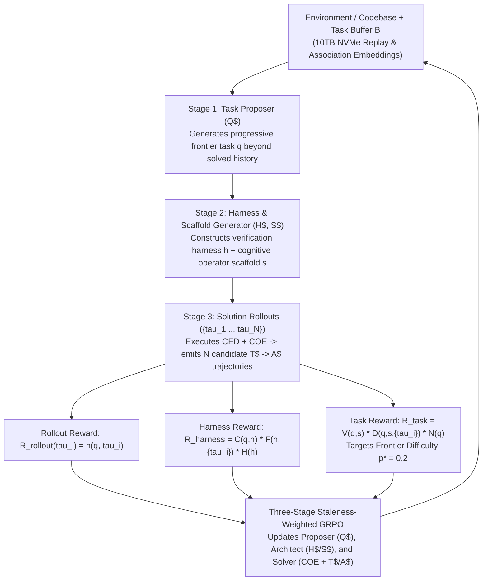

# 05. Ornith-1.0 Self-Scaffolding & Ornith-1.5 End-to-End Self-Improvement in `MCL4-COE`

Inspired by [Ornith-1.0: Self-Scaffolding LLMs for Agentic Coding](https://ornith.ai/ornith_1_0.html), [Ornith-1.5: From Self-Scaffolding to Self-Improvement](https://ornith.ai/ornith_1_5.html), and the RL/topology mechanics in `mini` (`chat_rl.py` and `expert_lifecycle.py`), **`MCL4-COE` implements both Ornith-1.0 (two-stage self-scaffolding) and Ornith-1.5 (three-stage autonomous task, harness/scaffold, and solution self-improvement) natively inside its Cognitive Operator Ensemble (`COE`).**

---

## 1. The Progression: Ornith-1.0 vs. Ornith-1.5 Inside `MCL4-COE`

| Mode | Stages Jointly Optimized with GRPO | Compact Protocol Framing | When to Use |
| :--- | :--- | :--- | :--- |
| **Ornith-1.0 Mode** (*Self-Scaffolding*) | **2 Stages:** 1. Scaffold Proposal (`S$`) 2. Solution Rollout (`T$ -> A$`) | `U$ {fixed_task}` `-> S$ {scaffold + COE schedule}` `-> T$ {trace} -> A$ {answer}` | When training on a fixed benchmark or user-supplied task set where the verifier is already given. |
| **Ornith-1.5 Mode** (*Full Self-Improvement*) | **3 Stages:** 1. Task Proposal (`Q$`) 2. Harness & Scaffold (`H$, S$`) 3. Solution Rollout (`T$ -> A$`) | `Env$ {domain/history}` `-> Q$ {generated_task}` `-> H$ {harness} S$ {scaffold}` `-> T$ {trace} -> A$ {answer}` | Autonomous curriculum expansion: the model invents harder tasks at its $p^* = 0.2$ capability frontier, builds verifiable harnesses + scaffolds, and solves them. |

---

## 2. Ornith-1.0 Mode: Two-Stage Self-Scaffolding (`U$ -> S$ -> COE -> T$ -> A$`)

In Ornith-1.0 Mode, tasks $q$ and external verifiers are provided by the environment, and the model co-evolves the **scaffold $s$** alongside the **solution policy $\pi_\theta$**.

### 2.1 Why `CED` + `COE` Eliminates ChatML Scaffold Bloat
In `mini/src/mini_moe/chat_rl.py`, quoting a previous plan inside ChatML required 6-character JSON escapes (`\u003c`) and consumed a large portion of the 256/512-byte window (`scaffold_context_requirement`).
In `MCL4-COE`:
1. **Stage 1 — Scaffold Evolution (`(U$, S_prev$) -> S$`):**
   * Conditioned on `<bos>U$ {task}\nS_prev$ {cached_best_scaffold}\n`, the model samples $G$ candidate scaffolds $\lbrace S^{(1)}, \dots, S^{(G)} \rbrace$.
   * Each scaffold $S^{(g)}$ specifies both the **Cognitive Operator Schedule** (which `COE` heads to invoke and in what order, e.g., `[Abduction -> Association -> Deduction -> Metacognition -> Inference]`) and a compact strategy (`<= 32`–`64` tokens).
2. **Stage 2 — Zero-Escape `CED` Solution Rollout (`(U$, S$) -> COE -> T$ -> A$`):**
   * The lower `CED` encoder layers encode `<bos>U$ {task}\nS$ {scaffold}\n` **once** into global keys/values $(K_{\mathrm{global}}, V_{\mathrm{global}})$.
   * The upper `CED` decoder layers execute the scheduled `COE` operators and emit `T$ {trace}\nA$ {answer}<eos>`.
3. **Joint Two-Stage Credit Assignment & Cache Retention:**
   * The terminal reward $R(q, \tau_i) \in [-1, 1]$ computes group-normalized advantages $A_i = (R_i - \mu_R) / (\sigma_R + \epsilon)$, updating **both Stage 1 (`S$`) and Stage 2 (`COE + T$ + A$`)**.
   * Whenever $\max_i R_i > \max(0, R_{\mathrm{cached}})$, `best_scaffolds[task_id]` is updated with the new winning scaffold.

---

## 3. Ornith-1.5 Mode: Three-Stage End-to-End Self-Improvement (`Q$ -> H$/S$ -> T$/A$`)

Ornith-1.5 shifts from self-scaffolding on a static dataset to a **closed, open-ended self-improvement loop** where the model continuously expands its own training curriculum:

### 3.1 Stage 1: Task Reward ($R_{\mathrm{task}}$) — Validity $\times$ Frontier Difficulty $\times$ Novelty
Following [Ornith-1.5](https://ornith.ai/ornith_1_5.html), for a generated question/task $q$, its scaffold $s$, and $N$ sampled solution rollouts $\lbrace \tau_i \rbrace_{i=1}^N$, the task proposer is rewarded by the multiplicative objective:

$$
R_{\mathrm{task}}(q, s, \lbrace \tau_i \rbrace_{i=1}^N) = \underbrace{V(q, s)}_{\text{Validity and Verifiability}} \times \underbrace{D\left(q, s, \lbrace \tau_i \rbrace_{i=1}^N\right)}_{\text{Frontier Difficulty}} \times \underbrace{N(q)}_{\text{Novelty}}
$$

1. **Validity and Verifiability $V(q, s) \in [0, 1]$ (with Hard Gate):**
   * Checks whether $q$ is coherent/solvable, whether the scaffold/harness executes cleanly, whether known positive solutions pass and negative perturbations fail, and whether the evaluation matches the task specification.
   * Treated as a **hard gate**:

$$
V(q, s) = 0 \implies R_{\mathrm{task}} = 0
$$

   * Malformed or unsolvable tasks never receive reward simply for looking "hard."
2. **Frontier Difficulty $D(q, s, \lbrace \tau_i \rbrace)$ Targeting $p^{\star} = 0.2$:**
   * From the $N$ sampled rollouts, compute the empirical pass rate:

$$
p = \frac{1}{N} \sum_{i=1}^N \mathbf{1}\left[s(q, \tau_i) = \text{success}\right]
$$

   * Reward tasks whose empirical pass rate sits near the **capability frontier $p^{\star} = 0.2$**:

$$
D(q, s, \lbrace \tau_i \rbrace) = \exp\left(-\frac{(p - p^{\star})^2}{2\sigma^2}\right), \qquad p^{\star} = 0.2
$$

   * **Why $p^{\star} = 0.2$ is crucial:** A 20% success rate guarantees that the task is near the outer edge of what the model can currently solve, while still producing at least 1–2 successful rollouts per group ($N = 8$ or $16$) so GRPO has non-zero advantage variance! As the policy masters a task ($p \to 1.0$), $D \to 0$ automatically, forcing the proposer to invent harder problems.
3. **Novelty and Diversity $N(q)$ via `COE` `Association` Embeddings:**
   * Against the buffer $\mathcal{B}$ of previously generated or trained-on tasks:

$$
N(q) = 1 - \max_{q_j \in \mathcal{B}} \operatorname{sim}(q, q_j)
$$

   * **How `MCL4-COE` computes $N(q)$ in `<0.1 ms`:** Every task $q$ already has a 32-dimensional centered **`Association` feature vector** (`pearson_similarity`) from the shared `MCL4-CED` backbone! Computing $\max_{q_j \in \mathcal{B}} \operatorname{sim}(q, q_j)$ over 100,000 past tasks is a single matrix-vector dot product in RAM/VRAM with zero external embedding model required.

### 3.2 Stage 2: Harness & Scaffold Reward ($R_{\mathrm{harness}}$)
For a generated task $q$, the evaluation harness $h$ (and scaffold $s$) is rewarded for being aligned, faithful, and hack-resistant:

$$
R_{\mathrm{harness}}(q, h, \lbrace \tau_i \rbrace) = \underbrace{C(q, h)}_{\text{Task Alignment}} \times \underbrace{F\left(h, \lbrace \tau_i \rbrace\right)}_{\text{Reward Fidelity}} \times \underbrace{H(h)}_{\text{Hack Resistance}}
$$

Each factor maps directly to **`MCL4-COE`'s native Cognitive Operators** plus deterministic checks:
* **Task Alignment $C(q, h)$:** Scored jointly by deterministic syntax/schema validation and `MCL4-COE`'s **`Deduction` + `Association` heads** (measuring whether the assertions in $h$ are logically entailed by the specification in $q$).
* **Reward Fidelity $F(h, \lbrace \tau_i \rbrace)$:** Measures rank correlation between the harness score $h(q, \tau_i)$ and the frozen reference **`Evaluation` utility head** across candidate rollouts $\lbrace \tau_i \rbrace$ (plus synthetic corrupted negative rollouts $\tau_{\mathrm{neg}}$ that must score $0$).
* **Hack Resistance $H(h)$:** Measures whether adversarial shortcut rollouts (e.g., returning a constant literal, touching an output file without computing, or skipping `T$` deduction steps) are properly rejected by $h$ and the deterministic boundary monitor.

### 3.3 Stage 3: Rollout Reward ($R_{\mathrm{rollout}}$)
Each candidate solution trajectory $\tau_i = (T^{(i)}, A^{(i)})$ is scored by the verified harness:

$$
R_{\mathrm{rollout}}(\tau_i) = h(q, \tau_i)
$$

combining binary pass/fail verification with criterion completion, efficiency, and `Deduction` trace consistency.

**All three stages (`Q$`, `H$/S$`, and `T$/A$`) are updated with GRPO using their respective rewards ($R_{\mathrm{task}}, R_{\mathrm{harness}}, R_{\mathrm{rollout}}$)!**

---

## 4. Staleness-Weighted Pipeline GRPO & Anti-Reward-Hacking Guard

### 4.1 Ornith Staleness Weighting $w(d_t)$
To support high-throughput asynchronous **NVFP4 rollout waves**, tokens/decisions generated at policy age $d_t = v_{\mathrm{current}} - v_{\mathrm{beh}}$ are weighted by Ornith's piecewise exponential decay:

$$
w(d_t) = \begin{cases}
1, & \text{if } d_t \le K_1, \\
\exp\bigl(-\lambda (d_t - K_1)\bigr), & \text{if } K_1 < d_t \le K_2, \\
0, & \text{if } d_t > K_2,
\end{cases}
$$

with token-level GRPO loss:

$$
\mathcal{L}_t = -\min\Bigl(r_t A_t, \quad \mathrm{clip}(r_t, 1 - \epsilon^-, 1 + \epsilon^+) A_t\Bigr) \cdot w(d_t), \qquad r_t = \frac{\pi_\theta(y_t \mid x, y_{<t})}{\pi_{\theta_t^{\mathrm{beh}}}(y_t \mid x, y_{<t})}
$$

* Any rollout crossing an `ExpertLifecycle` topology mutation (`topology_version` change) immediately receives $w(d_t) = 0$.

### 4.2 Three-Layer Anti-Reward-Hacking Defense
1. **Immutable Outer Trust Boundary:** Git history stripping, network isolation, and read-only verifier execution ensure neither `H$`, `S$`, nor `A$` can access oracle answers or mutate the grading runner.
2. **Deterministic Boundary Monitor:** Flags any trajectory that attempts to read withheld paths, hardcode test constants, or bypass required interfaces—assigning $R = 0$ and excluding it from advantage normalization.
3. **In-Network Frozen `COE` Veto (`Deduction` + `Evaluation` + `Metacognition`):** A frozen reference snapshot of the `Deduction` and `Evaluation` heads checks whether the trace `T$` genuinely entails `A$` under `U$/Q$`, vetoing lucky guesses or degenerate harnesses in `<1 ms`.

---

## 5. Bounded Structural Self-Improvement (`ExpertLifecycle`)

Alongside Ornith-1.0/1.5 behavioral self-improvement, `MCL4-COE` co-evolves its **physical MoE expert capacity** via [`mini`'s `ExpertLifecycle`](https://github.com/mESmaC/mini):
* **Speculative Expert Mitosis (`grow_experts`):** As Ornith-1.5 generates harder tasks at the $p^* = 0.2$ frontier, heavily loaded experts split with orthogonal perturbation and matched `CPUOffloadAdamW` state expansion (up to `max_parameters`).
* **Staleness Pruning (`prune_experts`):** Experts that fail to specialize or become obsolete after `prune_after_groups` are pruned cleanly while preserving their birth/prune audit history.
