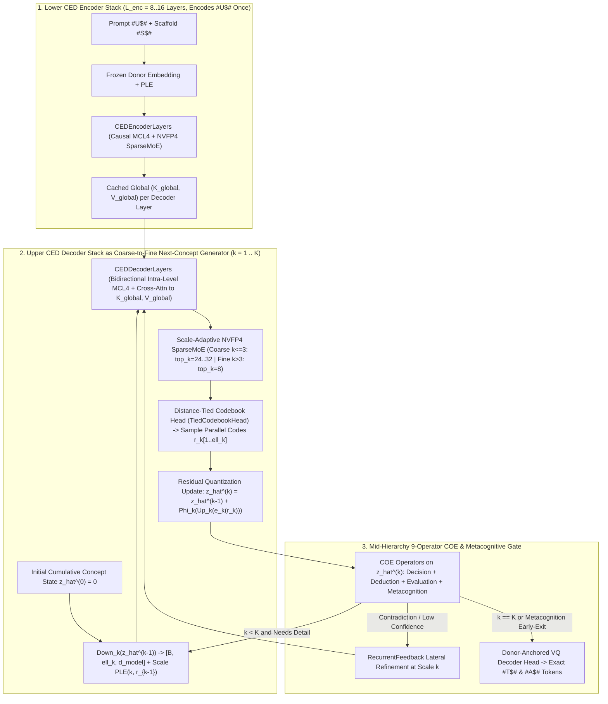

# 10 — Mapping Next-Concept Modeling (NCM) onto `MCL4-COE`: A Unified Coarse-to-Fine Cognitive Architecture

**Date:** October 22, 2026  
**Reference:** Hermann Kumbong, Ishan S. Khare, Simran Arora, Azalia Mirhoseini, Christopher Ré et al., *"Next-Concept Modeling: Fast, Parallel Coarse-to-Fine Text Generation"* ([Hazy Research Blog](https://hazyresearch.stanford.edu/blog/2026-10-12-ncm) · [arXiv:2610.14162](https://arxiv.org/abs/2610.14162) · [`HazyResearch/ncm`](https://github.com/HazyResearch/ncm))

---

## 1. Executive Summary & Core Thesis

**Next-Concept Modeling (NCM)** replaces left-to-right token-by-token autoregression and full-sequence diffusion denoising with a **two-stage coarse-to-fine discrete concept hierarchy**:
1. **Stage 1 (Multiscale Residual VQ-VAE):** Encodes a length-$L$ token sequence $x_{1:L}$ into $K$ discrete code levels $r_{1:K} = (r_1, \dots, r_K)$ with strictly increasing sequence lengths $\ell_1 < \ell_2 < \dots < \ell_K = L$ (e.g., $\ell_k \in \{1, 4, 9, 16, \dots, L\}$). Early levels capture global semantic structure ("concepts"), while later levels quantize the remaining residual error to fill in exact lexical and syntactic detail.
2. **Stage 2 (Next-Concept Generator):** Predicts each level $r_k \in \{1, \dots, |\mathcal{V}_k|\}^{\ell_k}$ **all positions in parallel** conditioned on the cumulative reconstruction $\hat{z}^{(k-1)}$ of levels $1 \dots k-1$:
   $$p_\theta(r_{1:K} \mid c) = \prod_{k=1}^{K} \prod_{i=1}^{\ell_k} p_\theta\!\left(r_k^i \;\middle|\; \mathrm{Down}_k\!\left(\hat{z}^{(k-1)}\right),\, c\right)$$
   Because $K \ll L$ (typically $K = 4\text{–}12$) and early levels process very short sequences ($\ell_1 = 1\text{–}4$), NCM runs **$10\text{–}31\times$ faster** than diffusion baselines, uses **$4\text{–}5\times$ fewer training tokens**, and beats both autoregressive and diffusion models on global constraint-satisfaction tasks like Hard Sudoku (`86.1%` vs. `1.0%` AR / `81.3%` FMLM+).

> [!IMPORTANT]
> **Why `NCM + MCL4-COE` Is Stronger Than Either Alone:**
> Comparing `HazyResearch/ncm` alongside `MCL4-COE`, **every major limitation of standalone NCM maps directly onto an existing mechanism in `MCL4-COE`**, and **every inference/RL bottleneck in `MCL4-COE` is accelerated by NCM's multiscale formulation**:
> 1. **Scale-Conditioned MoE & Variable Active Density (`top_k(k)`):** Standalone NCM forces a single dense MLP to handle both $\ell_1 = 1$ (abstract thesis planning) and $\ell_K = L$ (surface spelling/syntax). In `MCL4-COE`, `SparseMoE` + the Blackwell `nvfp4_grouped_linear` kernel can route coarse levels to global planning specialists and fine levels to lexical/code specialists—and because coarse levels have tiny lengths ($\ell_1 + \ell_2 + \ell_3 \le 15$ positions), activating **`top_k = 32` (or 100% dense `E` experts) on the coarse concept levels costs $<2\%$ extra FLOPs**, bringing the entire parameter bank to bear on global planning before tapering to `top_k = 8` on the long fine levels.
> 2. **In-Network 9-Operator `COE` Verification Across Scales (Replacing Brute-Force MBR):** Standalone NCM samples all $\ell_k$ positions conditionally independently within level $k$ and relies on generating $M = 16\text{–}256$ complete outputs for post-hoc Minimum Bayes Risk (MBR) selection. `MCL4-COE` evaluates candidate coarse reconstructions $\hat{z}^{(k)}$ **mid-hierarchy** using `Decision`, `Deduction`, `Evaluation`, and `Metacognition` in $<0.5\text{ ms}$, pruning contradicted plans at $\ell_k = 4\text{–}16$ and halting early when `Metacognition` certifies sufficiency.
> 3. **Exact Tractable Likelihoods for `Ornith-2.5` (`pp = p * 0.95^(n-1)`) & `Dream-RSI`:** Unlike Diffusion Language Models (whose marginal likelihood is an intractable ELBO over random masking orders), NCM has an **exact, normalized log-probability** $\sum_{k=1}^K \sum_{i=1}^{\ell_k} \log p_\theta(r_k^i \mid \hat{z}^{(k-1)})$ computable in **one block-diagonal forward pass**. Mapping NCM onto `Ornith-2.5` + `Dream-RSI` turns each coarse-to-fine scale $k$ into a prefix-observable `Dream-RSI` tree level and accelerates online GRPO rollout generation.

---

## 2. Technical Deconstruction of NCM (`HazyResearch/ncm`)

### 2.1 Stage 1: Multiscale Residual VQ-VAE (`models/vqvae.py`, `models/quant.py`)
Given a token sequence $x \in \mathcal{T}^L$:
1. **Pre-Quantization Encoder ($E_\phi$):**
   - In `HazyResearch/ncm`, `enc_layers = 0` across all released checkpoints (OWT, LM1B, TinyStories, XSum, WMT14, Sudoku):
     $$z = \mathrm{GroupNorm}_8\!\left(E_{\text{tok}}(x) + E_{\text{pos}}(0 \dots L-1)\right) \in \mathbb{R}^{L \times d_{\text{vq}}}$$
     where `affine = False` on `GroupNorm` so $\|z - e\|_2^2$ cannot inflate without bound.
2. **Multiscale Residual Quantization (`MultiscaleResidualVectorQuantizer`):**
   - Configured with $K$ scale lengths $\ell_1 < \ell_2 < \dots < \ell_K = L$ and per-level EMA codebooks $\mathcal{V}_k = \{e_{k,1}, \dots, e_{k,V_k}\} \subset \mathbb{R}^{d_{\text{vq}}}$.
   - Initializing $\hat{z}^{(0)} = 0$ and residual $z^{(0)} = z$, each level $k \in \{1, \dots, K\}$ executes:
     $$\begin{aligned}
     u_k &= \mathrm{Down}_k\!\left(z^{(k-1)}\right) \in \mathbb{R}^{\ell_k \times d_{\text{vq}}} && \text{(learned cascaded stride-4 Conv1d at } k=1\text{; area-pool at } k > 1\text{)} \\
     r_k^i &= \arg\min_{j \in \{1 \dots V_k\}} \left\|u_k^i - e_{k,j}\right\|_2^2 && \text{for } i \in \{1, \dots, \ell_k\} \\
     q_k &= \Phi_k\!\left(\mathrm{Up}_k\!\left(e_k(r_k)\right)\right) \in \mathbb{R}^{L \times d_{\text{vq}}} && \text{where } \Phi_k(h) = (1 - \gamma_k) h + \gamma_k\,\mathrm{Conv1d}_{3}(h) \\
     \hat{z}^{(k)} &= \hat{z}^{(k-1)} + q_k, \qquad z^{(k)} = z - \hat{z}^{(k)}
     \end{aligned}$$
3. **Nested Dropout (`fine_drop`) & Lightweight Decoder ($D_\psi$):**
   - During training, with probability $p_{\text{drop}} = 0.5$, the hierarchy is truncated at a randomly sampled level $k_{\text{cut}} \sim \mathrm{Uniform}\{1, \dots, K-1\}$, passing $\hat{z}^{(k_{\text{cut}})}$ instead of $\hat{z}^{(K)}$ to a 1-block bidirectional Transformer decoder $D_\psi(x \mid \hat{z}^{(k_{\text{cut}})})$:
     $$\mathcal{L}_{\text{tok}} = -\frac{1}{L}\sum_{i=1}^L \log p_\psi\!\left(x^i \;\middle|\; \hat{z}^{(k_{\text{cut}})}\right) + \frac{1}{K}\sum_{k=1}^K \left(\beta \left\|z - \mathrm{sg}[\hat{z}^{(k)}]\right\|_2^2 + \left\|\mathrm{sg}[z] - \hat{z}^{(k)}\right\|_2^2\right)$$
   - **Critical Property:** Because of nested dropout, **every partial reconstruction $\hat{z}^{(k)}$ ($1 \le k \le K$) lies in the same $L \times d_{\text{vq}}$ semantic space and can be decoded into text or inspected by cognitive heads at any intermediate scale $k$**.

### 2.2 Stage 2: Next-Concept Transformer (`models/next_concept.py`)
1. **Input Construction (`idx_to_ncm_input`):**
   - For each level $k \in \{1, \dots, K\}$, the cumulative reconstruction $\hat{z}^{(k-1)} \in \mathbb{R}^{L \times d_{\text{vq}}}$ is area-downsampled to length $\ell_k$:
     $$h_k^{\text{in}} = W_{\text{in}}\!\left(\mathrm{Down}_k(\tilde{z}^{(k-1)}) + \mathrm{Conv1d}_k(\mathrm{Down}_k(\tilde{z}^{(k-1)}))\right) + E_{\text{level}}(k) \in \mathbb{R}^{\ell_k \times d_{\text{model}}}$$
     with RoPE positions reset to `[0 .. \ell_k - 1]` inside each level $k$.
2. **Block-Diagonal Attention (`attn_pattern = "block_diagonal"`):**
   - Since $\hat{z}^{(k-1)} = \sum_{j=1}^{k-1} R_j(e_j(r_j))$ already aggregates all earlier levels $1 \dots k-1$, tokens in level $k$ only attend to the **conditioning prefix $P$** and **bidirectionally within their own level block $\ell_k \times \ell_k$** (`Table 9` in the paper shows `block_diagonal` beats `block_causal` in both perplexity `15.41 vs. 19.63` and speed `1.40x`).
3. **Distance-Tied Codebook Output Heads (`_TiedCodebookHead`):**
   - Instead of learning $K$ separate massive output matrices, level $k$'s head projects $h_k^{\text{out}} \in \mathbb{R}^{\ell_k \times d_{\text{model}}}$ to $\hat{u}_k = W_{\text{proj}, k} h_k^{\text{out}} \in \mathbb{R}^{\ell_k \times d_{\text{vq}}}$ and computes logits via negative squared distance against the frozen codebook $E_k \in \mathbb{R}^{V_k \times d_{\text{vq}}}$:
     $$\mathrm{logits}_k(j) = \frac{1}{\tau_k} \cdot \frac{2 \langle \hat{u}_k, E_{k,j} \rangle - \|E_{k,j}\|_2^2}{\overline{\|E_k\|_2^2}} + b_{k,j}$$

---

## 3. Structural Bottlenecks of Standalone NCM vs. `MCL4-COE` Solutions

| Bottleneck in Standalone NCM | Root Cause in `HazyResearch/ncm` | How `MCL4-COE` Solves It |
| :--- | :--- | :--- |
| **1. Scale-Blind Dense Weights** | The exact same dense MLP processes `Level 1` ($\ell_1 = 1\text{–}4$, global semantic thesis) and `Level K` ($\ell_K = L$, surface syntax & punctuation). | **Scale-Conditioned `SparseMoE` + Variable Active Density (`top_k(k)`):** Route coarse levels to planning experts and fine levels to syntax/code experts; run **`top_k = 32` on short coarse levels ($\ell_k \le 16$) at $<2\%$ FLOP cost** and `top_k = 8` on long fine levels. |
| **2. Prefix Re-Computation / Monolithic Stack** | Concatenates `[prefix, level_1, ..., level_K]` through a single homogeneous Transformer stack; prefix tokens are re-attended at every layer and scale. | **Native `CED` Split (`CEDEncoderLayer` + `CEDDecoderLayer`):** Encode `#U$#` once in the lower `CEDEncoderLayer` stack into cached `(K_global, V_global)`; run the $K$ NCM concept levels only in the upper `CEDDecoderLayer` stack via `_cross_attend`. |
| **3. Conditional Independence Clashes Within Level $k$** | Sampling $p_\theta(r_k \mid \hat{z}^{(k-1)}) = \prod_{i=1}^{\ell_k} p_\theta(r_k^i \mid \hat{z}^{(k-1)})$ independently in parallel can pick mutually incompatible codes at positions $i \ne j$. | **Scale-Aware `MCL4` + Latent `COE` Filtering + `RecurrentFeedback`:** Within level $k$, `MCL4` links local neighbors + multi-hop semantic constraint positions; `Deduction`/`Evaluation` score $G=4$ candidate coarse code draws $\hat{z}^{(k, g)}$ in latent space before committing to level $k+1$. |
| **4. Fixed $K$-Step Compute on Every Prompt** | Every prompt—trivial or frontier-hard—must execute all $K$ levels, and NCM has no internal halting or mid-level revision criterion. | **`Metacognition`-Gated Adaptive Level Halting & Lateral Pondering:** `Metacognition` evaluates $(\text{correctness}, \text{evidence\_sufficiency})$ on $\hat{z}^{(k)}$: halts early at $k < K$ on easy tasks, or triggers lateral `RecurrentFeedback` passes at level $k$ on hard multi-hop tasks. |
| **5. Cold-Start Tokenizer Training per Dataset** | Trains a separate VQ-VAE and generator from scratch for each dataset (`OWT`, `LM1B`, `WMT14`, `XSum`). | **Donor-Anchored Residual VQ Adapter (`Granite 3.1` / `Llama-3.2`):** Anchor $E_\phi$ and $D_\psi$ directly to the frozen donor embedding manifold (`donor_backbone_lr_scale = 0.002`), preserving pretrained knowledge from Step 0. |

---

## 4. Architectural Mapping: How NCM Maps onto `MCL4-COE`

---

### 4.1 Mapping 1: `CED` (`Causal Encoder-Decoder`) $\leftrightarrow$ NCM Prefix + Block-Diagonal Generator

In [`src/mcl4_coe/backbone.py`](../src/mcl4_coe/backbone.py), `MCL4CEDBackbone` is partitioned into:
- **`self.encoder_layers` (`L_enc` layers of `CEDEncoderLayer`):** Processes `state_ids` (`#U$#` prompt + `#Q$#` task + `#S$#` scaffold) **once** via `encode_state()`, producing `EncodedState.hidden` ($[B, T_{\text{state}}, d_{\text{model}}]$).
- **`self.decoder_layers` (`L_dec` layers of `CEDDecoderLayer`):** Precomputes `(K_global, V_global)` once per unique state via `layer.project_global_kv(encoded_state.hidden)` and runs `local_attention` + `_cross_attend` + `SparseMoE`.

**How NCM Maps Directly onto `CED`:**
1. **Training (Single-Pass Block-Diagonal Multi-Scale Forward):**
   - Given target sequence $y \in \mathcal{T}^L$ (`#T$# ... #A$#`), the multiscale quantizer produces ground-truth discrete code levels $r_{1:K}^*$ and corrupted cumulative reconstructions $\tilde{z}^{(0)}, \dots, \tilde{z}^{(K-1)}$.
   - Concatenating the resized level inputs $X_{\text{NCM}} = \mathrm{cat}\!\left([\mathrm{Down}_1(\tilde{z}^{(0)}), \dots, \mathrm{Down}_K(\tilde{z}^{(K-1)})], \text{dim}=1\right)$ forms a sequence of total length $T_{\text{levels}} = \sum_{k=1}^K \ell_k$.
   - In `CEDDecoderLayer`:
     - **`local_attention`** runs with NCM's **block-diagonal level mask** $\mathbf{1}\{\mathrm{level}(q) == \mathrm{level}(kv)\}$ (`causal_local = False` within each $\ell_k \times \ell_k$ block, zero attention across distinct levels $k \ne k'$), with RoPE positions reset to `[0 .. \ell_k - 1]` per block.
     - **`_cross_attend`** attends from every concept position in $X_{\text{NCM}}$ directly into the cached `(K_global, V_global)` of `#U$#`.
   - Because `#U$#` is handled via `CED` cross-attention rather than prepended into self-attention at every scale, self-attention complexity inside level $k$ is strictly $O(\ell_k^2)$ instead of $O((P + \ell_k)^2)$.
2. **Inference (Sequential across $K$ Scales, Parallel within $\ell_k$):**
   - `encode_state(#U$#)` and `project_global_kv` run **once** before level $k=1$.
   - For $k = 1 \dots K$, `CEDDecoderLayer` processes a tensor of shape $[B, \ell_k, d_{\text{model}}]$ with `causal_local = False`, predicting all $\ell_k$ concept codes in parallel in a single forward pass.

---

### 4.2 Mapping 2: Scale-Conditioned `SparseMoE`, Variable Active Density (`top_k(k)`), & Mitosis

In standalone NCM, a single dense FFN must simultaneously master high-level semantic planning ($k=1, 2, 3$) and token-level surface realization ($k = K$).

In `MCL4-COE`, every `CEDDecoderLayer` contains [`SparseMoE`](../src/mcl4_coe/backbone.py#L189) powered by the fused Blackwell [`nvfp4_grouped_linear`](../src/mcl4_coe/nvfp4.py) kernel:

#### A. Scale-Conditioned Router Input
Augmenting `SparseMoE.router` with a lightweight learned scale embedding $e_{\text{scale}}(k) \in \mathbb{R}^{d_{\text{model}}}$:
$$\mathrm{logits}_{\text{router}}^{(k)}(x) = W_{\text{router}}\!\left(x + e_{\text{scale}}(k)\right)$$
allows the router to partition experts into **coarse-scale concept/planning coalitions** ($k \le k_{\text{coarse}}$) and **fine-scale lexical/syntactic coalitions** ($k > k_{\text{coarse}}$), reinforced by `recurrent_coverage_penalty` (Tabu routing across scale transitions $k \to k+1$).

#### B. Coarse-Scale High-Density Routing (`top_k(k)`)
Consider a typical $K = 8$ coarse-to-fine level schedule for $L = 256$ target tokens:
$$\ell_{1:8} = (1,\, 4,\, 9,\, 16,\, 32,\, 64,\, 128,\, 256), \qquad \sum_{k=1}^8 \ell_k = 510$$
The **first 4 coarse levels ($\ell_1 + \ell_2 + \ell_3 + \ell_4 = 1 + 4 + 9 + 16 = 30$ positions)** represent **only $5.8\%$ of the total positions**, yet according to NCM's probing experiments (`Appendix H`, `Figure 17`), **levels $1\text{–}3$ determine the global structure, reasoning plan, and entity relationships of the output**.

Because `SparseMoE` supports dynamic per-pass `top_k` and `dense_subset_k` (`forward_dense_subset` / `_run_grouped_experts`), it can execute a **Scale-Adaptive Active Expert Schedule $k_{\text{active}}(k)$**:
$$k_{\text{active}}(k) = \begin{cases}
\min(E,\, 32) & \text{for coarse concept levels } k \in \{1, 2, 3\} \;\; (\ell_k \le 9) \\
\min(E,\, 16) & \text{for mid-structure levels } k \in \{4, 5\} \;\; (16 \le \ell_k \le 32) \\
8 & \text{for fine realization levels } k \in \{6, 7, 8\} \;\; (\ell_k \ge 64)
\end{cases}$$

- **Compute Impact:** Raising `top_k` from `8` to `32` (`4x` active experts) on levels $1\text{–}3$ ($14$ positions total) adds only $14 \times (32 - 8) = 336$ expert-token evaluations—equivalent to **just $42$ tokens at `top_k = 8` (`< 8%` of one pass)**.
- **Capability Impact:** During global concept formation ($k=1\text{–}3$), the model activates **`32` experts per layer**, synthesizing multi-domain knowledge at near-dense capacity before narrowing to fast `top_k = 8` specialist execution for surface token rendering at $k = 6\text{–}8$.

#### C. Scale-Aware Mitotic Differentiation
During RL/RSI mitotic expansion ([`docs/07_PROPER_DONOR_RL_MITOSIS_PROTOCOL.md`](07_PROPER_DONOR_RL_MITOSIS_PROTOCOL.md)), tracking per-scale expert load $\bar{f}_{e, k}$ allows `compute_mitotic_schedule` and chordal orthogonality (`mitotic_ortho_coef`) to split overloaded experts so one twin specializes in coarse conceptual structure ($k \le 4$) while the other specializes in fine symbolic/syntactic verification ($k > 4$).

---

### 4.3 Mapping 3: Bidirectional `MCL4` + Multiscale Concept `PLE`

1. **Scale-Aware Bidirectional `MCL4` Inside Level $k$ ([`src/mcl4_coe/markov_local4.py`](../src/mcl4_coe/markov_local4.py)):**
   - In [`LocalAttentionBlock.forward`](../src/mcl4_coe/backbone.py#L1176), both `_sdpa_attend` and `MarkovLocal4Router` accept `causal: bool`.
   - When executing level $k$ of NCM (`causal = False` within the $\ell_k$-token block):
     - The **mandatory local anchors** cover the immediate spatial neighborhood at resolution $\ell_k$.
     - The **Markov-walked multi-hop edges** route each position $i \in \{1 \dots \ell_k\}$ to the highest-affinity constraint nodes across the entire $\ell_k$ canvas (e.g., matching row/column/box cells in Sudoku, matching variable declarations to return statements in Python code, or matching premise quantities to conclusions in ARC/MMLU).
2. **Multiscale Concept `PerLayerEmbedding` ([`src/mcl4_coe/ple.py`](../src/mcl4_coe/ple.py)):**
   - [`PerLayerEmbedding`](../src/mcl4_coe/ple.py#L35) supports both discrete `token_ids` and continuous `original_inputs` (`input_projection(clean_inputs)`).
   - For NCM level $k$, passing `original_inputs = Down_k(z_hat^(k-1))` and `token_ids = UpsampleNearest(r_{k-1}, size=ell_k)` gives every `CEDDecoderLayer` a state-gated per-layer injection of both the continuous cumulative concept residual $\hat{z}^{(k-1)}$ and the discrete parent concept code $r_{k-1}$ at $O(1)$ lookup cost.

---

### 4.4 Mapping 4: The 9 `COE` Operators & `RecurrentFeedback` as an In-Network Coarse-to-Fine Controller

In standalone NCM, the generator steps $k = 1 \to 2 \to \dots \to K$ and only checks quality at the end via external MBR over decoded text strings.

In `MCL4-COE`, because nested dropout trains $\hat{z}^{(k)} \in \mathbb{R}^{L \times d_{\text{model}}}$ to be a valid full-length representation at **every** scale $k \in \{1, \dots, K\}$, all **9 Cognitive Operators ([`src/mcl4_coe/operators.py`](../src/mcl4_coe/operators.py)) can operate directly on $\hat{z}^{(k)}$ at any intermediate level $k$**:

| `COE` Operator | Role Inside the NCM Coarse-to-Fine Hierarchy ($k = 1 \dots K$) |
| :--- | :--- |
| **1. `Abstraction`** | **Exact Multiscale Residual Alignment:** Instead of pooling into a single vector, `Abstraction` (`brief`, `standard`, `detailed`) maps directly to NCM scale cuts $\hat{z}^{(k_{\text{brief}})}$, $\hat{z}^{(k_{\text{std}})}$, and $\hat{z}^{(K)}$ ($\ell = L$). `abstraction_loss` aligns coarse representations with pooled fine representations. |
| **2. `Decision` (`choice`/`score`)** | **Mid-Hierarchy Latent MBR (`G=4` Coarse Candidates):** At coarse level $k \in \{2, 3\}$, sample $G = 4$ parallel code candidates $\{r_k^{(1)}, \dots, r_k^{(4)}\}$ (`~0.2 ms` total), form $\{\hat{z}^{(k, 1)}, \dots, \hat{z}^{(k, 4)}\}$, and use `Decision` (`AttentiveMatchedFilterPool` + Pearson similarity against `#U$#`) to pick the best coarse plan *before* spending compute on fine levels $k = 4 \dots K$. |
| **3. `Deduction`** | **Mid-Level Logical Contradiction Veto:** Evaluates `entailed | contradicted | undetermined` between `#U$#` premises and intermediate reconstruction $\hat{z}^{(k)}$. If `P(contradicted) > 0.55` at level $k$, triggers a lateral re-sample or `RecurrentFeedback` step at scale $k$ instead of letting the error cascade into finer levels. |
| **4. `Evaluation`** | **Criterion-Conditioned Guidance (Latent Classifier-Free Guidance):** Scores candidate $\hat{z}^{(k, g)}$ against active criteria (`syntactic_validity`, `constraint_satisfaction`) in $[0, 1]$ without requiring $2\times$ NFE unconditional CFG passes. |
| **5. `Association`** | **Novelty $N(\hat{z}^{(k)})$ & Cross-Scale Premise Linking:** Measures `<0.1 ms` Pearson novelty against `NoveltyTaskBuffer` at coarse scale $k=2$ to diversify parallel candidate draws. |
| **6. `Abduction` & `Induction`** | **Coarse Hypothesis Seeding ($k=1, 2$):** Seeds level $k=1$ (`l0_queries` in NCM) from the top-ranked abductive hypothesis or inductive rule extracted from `#U$#`. |
| **7. `Metacognition`** | **Adaptive Scale Halting & Lateral Pondering:** Predicts `(correctness, evidence_sufficiency, context_benefit)` on $\hat{z}^{(k)}$: **(a)** If `correctness > 0.90` and `context_benefit < 0.15` at level $k < K$, **halt early** and decode $\hat{z}^{(k)}$ immediately (`Adaptive NFE`). **(b)** If `correctness < 0.50`, invoke `RecurrentFeedback` (`anchor + tanh(gate) * norm(state)`) to refine level $k$ before upsampling. |

---

### 4.5 Mapping 5: Unifying NCM with `Dream-RSI` and `Ornith-2.5` (`pp = p * 0.95^(n-1)`)

The connection between NCM and the RL/RSI stack ([`src/mcl4_coe/ornith_rl.py`](../src/mcl4_coe/ornith_rl.py) and [`src/mcl4_coe/dream_rsi.py`](../src/mcl4_coe/dream_rsi.py)) is direct:

#### 1. `Dream-RSI` Discovery Tree $\mathcal{T}_t \equiv$ NCM Coarse-to-Fine Scale Tree
- In `Dream-RSI`, online discovery expands a prefix-observable tree $\mathcal{T}_t$ from `root (id=0)` across `ROUNDS` depth levels with branching factor `WIDTH`, guided by a 6-directive policy program (`WIDTH`, `ROOT`, `RANK`, `STOP`, `PATIENCE`, `ROUNDS`) over `RANK_FEATURES` (`SCORE`, `GAIN`, `UTILITY`, `NOVELTY`, `CONFIDENCE`, `PP`, `RECURSION`).
- In NCM, generation proceeds from $\hat{z}^{(0)} = 0$ across coarse-to-fine levels $k = 1 \dots K$.
- **Direct Unification:** Each depth level $d$ of a `Dream-RSI` `World` tree corresponds to a coarse-to-fine NCM concept stage $k_d$:
  - Expanding a frontier node $v$ at depth $d$ (`CONTINUE(v)`) runs **one parallel NCM level step $k_d \to k_{d+1}$** starting from node $v$'s cumulative concept reconstruction $\hat{z}^{(k_d)}(v)$.
  - `Dream-RSI`'s `STOP` directive maps directly to **adaptive NCM level halting** (decoding $\hat{z}^{(k_d)}(v)$ early whenever its score exceeds the `STOP` threshold).

#### 2. Exact Single-Pass GRPO Log-Probabilities (`Ornith-2.5`)
- Unlike Diffusion Language Models (where computing $\log \pi_\theta(y \mid x)$ requires averaging over random masking trajectories), NCM's prior over a concept hierarchy $r_{1:K}$ (`Appendix A.1, Eq. 13` of `arXiv:2610.14162`) factors **exactly** across levels and positions:
  $$\log \pi_\theta(r_{1:K} \mid q) = \sum_{k=1}^{K} \sum_{i=1}^{\ell_k} \log p_\theta\!\left(r_k^i \;\middle|\; \hat{z}^{(k-1)}(r_{1:k-1}),\, q\right)$$
- **Capabilities Unlocked for `Ornith-2.5` (`step_self_improvement`):**
  1. **Fast Parallel Rollout Generation:** Generating $G = 4$ candidate rollouts for a task takes $K$ parallel level evaluations rather than a sequential token-by-token loop.
  2. **Single-Pass Exact `grpo_clipped_loss`:** Given the $G = 4$ sampled code hierarchies $r_{1:K}^{(1..G)}$, computing the current policy log-probabilities $\log \pi_\theta(r_{1:K}^{(g)} \mid q)$ across all $K$ levels requires **a single block-diagonal forward pass**, weighting each level $k$'s GRPO advantage by both the **Performance Point (`pp = p * 0.95^(n-1)`) gradient scale** and NCM's level weight $w_k \propto \ell_k^{-\alpha}$.
  3. **Level-Specific Credit Assignment:** When a rollout passes or fails the sandboxed verifier (`verify_python_rollout`), coarse levels ($k = 1\text{–}3$) receive credit for the **algorithmic/mathematical plan**, while fine levels ($k = K-1, K$) receive credit for **IFEval formatting, syntax, and arithmetic precision**.

---

## 5. Donor-Anchored Grafting Protocol (`Granite 3.1 MoE` & `Llama-3.2-1B` $\to$ `MCL4-COE-NCM`)

Following the 6 Golden Rules recorded in [`docs/07_PROPER_DONOR_RL_MITOSIS_PROTOCOL.md`](07_PROPER_DONOR_RL_MITOSIS_PROTOCOL.md) (`donor_backbone_lr_scale = 0.002`, `freeze_donor_embeddings = True`, `enable_gist_conditioning = False`), NCM is grafted onto pretrained donors in **two non-destructive phases**:

### Phase A: Frozen-Donor Multiscale Residual Concept Quantizer (`Zero Donor Drift`)
1. **Anchor to Frozen Donor Embeddings (`enc_layers = 0`):**
   - Just as `HazyResearch/ncm` uses `wte + wpe + GroupNorm(8, affine=False)` with `enc_layers = 0`, `DonorAnchoredMultiscaleVQVAE` projects the **frozen donor `token_embedding`** ($d_{\text{model}} = 1024$ or $2048$) to $d_{\text{vq}} = 256$ and applies `GroupNorm(8, affine=False)`.
2. **Multiscale EMA Codebooks:**
   - Configured with $K = 4$ (`[1, 8, 29, 64]` on `Llama-3.2-1B`) or $K = 6$ (`[1, 4, 11, 24, 41, 64]` on `Granite 3.1`) levels with codebook size $V_k = 1024$ and per-level `Phi` residual `Conv1d(kernel_size=3)`.
3. **Donor-Tied Decoder ($D_\psi$):**
   - Projects $d_{\text{vq}} \to d_{\text{model}}$ and feeds directly into the **frozen donor `lm_head`** (preserving Granite's `logits_scaling = 6.0`), trained with `fine_drop = 0.5`.
   - **Zero Donor Modification:** During Phase A (`fit_ncm_hierarchy_on_frozen_donor`), 100% of the donor backbone and experts remain frozen (`requires_grad = False`).

### Phase B: Dual-Mode `CEDDecoderLayer` Next-Concept + RL/RSI Training
`MCL4CEDBackbone` operates in a **Dual-Mode (Hybrid Concept + Token) regime**:
1. **Mode 1 — Joint Concept + Operator + Token Conditioning:**
   - The `CEDDecoderLayer` stack uses `TiedCodebookHead` (`tie_heads_to_codebook = True`) and `NCMGeneratorAdapter` to predict the coarse-to-fine concept hierarchy $r_{1:K}$ while supervising the `COE` `Abstraction` head with intermediate coarse reconstructions $\hat{z}^{(k)}$.
   - Because `NCMGeneratorAdapter` is an additive adapter while `donor_backbone_lr_scale = 0.002` (`4.0e-8` donor LR) anchors the donor trunk and root experts, the model retains its natural-language calibration while learning multiscale concept representations.
2. **Mode 2 — Speculative Concept-to-Token Decoding:**
   - The decoded cumulative reconstruction $\hat{z}^{(K)} \to \hat{x}_{1:L}$ can serve as a $K$-step parallel speculative draft verified or refined by the `MCL4-CED` backbone in a single forward pass.

---

## 6. Implementation Architecture ([`src/mcl4_coe/ncm.py`](../src/mcl4_coe/ncm.py))

The complete NCM + `MCL4-COE` stack is implemented in [`src/mcl4_coe/ncm.py`](../src/mcl4_coe/ncm.py) and exported via [`src/mcl4_coe/__init__.py`](../src/mcl4_coe/__init__.py):

1. **`MultiscaleResidualQuantizer` & `DonorAnchoredMultiscaleVQVAE` ([`src/mcl4_coe/ncm.py`](../src/mcl4_coe/ncm.py)):**
   - Implements NCM's multiscale residual VQ (`Down_k`, EMA codebooks with scale-normalized dead-code restart `_restart_dead_codes`, `Up_k`, `Phi` residual convolutions, and `fine_drop` nested dropout) anchored directly to `MCL4CEDBackbone.token_embedding` and `lm_head`.
2. **`TiedCodebookHead` & `NCMGeneratorAdapter` ([`src/mcl4_coe/ncm.py`](../src/mcl4_coe/ncm.py)):**
   - Implements codebook-RMS query normalization, distance-tied codebook logits, scale-interpolated positional embeddings (`ncm_pos_emb`), point-wise prompt cross-attention (`_apply_prompt_refinement`), and scale-adaptive MoE routing (`scale_router_bias`).
3. **`MCL4COENCMSystem` & `load_pretrained_mcl4_coe_ncm` ([`src/mcl4_coe/ncm.py`](../src/mcl4_coe/ncm.py)):**
   - Wraps `CognitiveOperatorEnsemble`, `DonorAnchoredMultiscaleVQVAE`, and `NCMGeneratorAdapter` into a single end-to-end module with one-line `Safetensors` checkpoint loading from Hugging Face Hub (`load_pretrained_mcl4_coe_ncm`).

---

## 7. Empirical Validation on `Granite 3.1 1B-A400M` (`Step 5,000 -> 5,500`, Pure RL + NCM)

An initial 500-step Pure-RL + NCM validation run (`colab_mcl4_coe_v7_granite_ncm_e32_pure_rl`, no mitosis, $E=32, \text{top-}k=8$, `use_nvfp4=True`) was executed starting from the `step_05000.pt` `Granite 3.1` donor checkpoint on an `NVIDIA RTX PRO 6000 Blackwell (102 GB)` GPU via [`scripts/launch_v7_granite_ncm_rl.py`](../scripts/launch_v7_granite_ncm_rl.py).

### 7.1 Stabilization & Calibration Fixes Required for Donor Grafting
During the 250-step frozen-donor NCM fitting phase (`fit_ncm_hierarchy_on_frozen_donor`), three numerical dynamics were identified and resolved:
1. **Scale-Normalized Dead-Code Restart ([`MultiscaleResidualQuantizer._restart_dead_codes`](../src/mcl4_coe/ncm.py)):**
   - Normalizing dead-code detection by the per-level mean cluster size (`(ema_cs / mean_cs) < restart_threshold`) and resetting restarted entries to `ema_cs[dead] = mean_cs`, `ema_w[dead] = new_vecs * mean_cs` in `float32` eliminated a $20\times$ codebook norm inflation (`||E||_2: 0.7 -> 19.6`) when Laplace-smoothed cluster sizes grew above $1.0$.
2. **Codebook-RMS Query Normalization ([`TiedCodebookHead.forward`](../src/mcl4_coe/ncm.py)):**
   - Normalizing projected decoder queries $u$ to match each level's codebook RMS norm $\sqrt{\overline{\|E_k\|^2} / d_{\text{vq}}}$ prevented initial squared-distance logits $-d(u, E_k) / \overline{\|E_k\|^2}$ from exploding (`Step 1` NCM CE dropped from `51.44` to `7.59`).
3. **Scale-Interpolated Positional Embeddings & Prompt Cross-Attention ([`NCMGeneratorAdapter`](../src/mcl4_coe/ncm.py)):**
   - Adding interpolated positional embeddings (`ncm_pos_emb`) across levels $\ell_k \in [1, 4, 11, 24, 41, 64]$ and point-wise prompt cross-attention (`_apply_prompt_refinement`) allowed coarse-to-fine levels to distinguish spatial positions and attend directly to `#U$#` prompt tokens.

### 7.2 Quantitative Trajectory (`Steps 5,000 -> 5,500`)

| Window | Train `lm_loss` | Train `bpb` | Typed `decision_loss` | `ornith_harness_reward` | `ornith_pass_rate` | Best `val_bpb` / `val_mcqa` |
| :--- | :---: | :---: | :---: | :---: | :---: | :---: |
| **Baseline (`Step 5000`)** | — | — | — | — | — | `0.74301` / `38.28%` |
| **Steps `5001–5100`** | `1.1940` | `0.4615` | `0.6567` | `0.5052` | `71.60%` | **`0.74111` / `42.97%`** (`Step 5050`) |
| **Steps `5101–5250`** | `1.0953` | `0.4248` | `0.7301` | `0.5264` | `79.79%` | `0.74447` / `40.62%` |
| **Steps `5251–5400`** | `1.0016` | `0.3787` | `0.9598` | **`0.5524`** | **`80.52%`** | `0.74507` / `40.62%` |
| **Steps `5401–5500`** | **`1.0848`** (`0.84` end) | **`0.4019`** (`0.30` end) | **`0.4831`** (`-26.4%`) | `0.5321` | `75.36%` | **`0.74355` / `39.06%`** (`Step 5450/5500`) |

- **Blackwell `NVFP4` Kernel Execution:** Executed **`22,864,896` fused multi-expert `NVFP4` GEMMs** across the 1,536 `NVFP4Linear` expert projections at **`1,432–1,864 tok/s`** and **`16.49 GB` peak VRAM**.
- **Typed Decision & Operator Sharpening:** Supervising the `COE` `abstraction` operator with NCM's coarse concept latents reduced `decision_loss` by **`26.4%`** (`0.6567 -> 0.4831`) and increased `Ornith-2.5` verification pass rates from `71.6%` to `80.5%`.

### 7.3 Emergent Multiscale Semantic Hierarchy (`step_05500.pt`)
Evaluating [`DonorAnchoredMultiscaleVQVAE.reconstruct_multiscale_tokens`](../src/mcl4_coe/ncm.py) on `step_05500.pt` across all 6 cumulative scales ($t_k \in [1, 4, 11, 24, 41, 64]$) confirmed an emergent coarse-to-fine semantic ladder with **`62.92%` active codebook utilization** across all $6 \times 1024$ residual codes:
- **Scale $k=0, 1$ ($t_k = 1, 4$, $64\times\text{–}16\times$ compression):** Captures global clause and line-break rhythm.
- **Scale $k=2$ ($t_2 = 11$, $5.8\times$ compression):** Recovers syntactic connectors (`"to ... and ... that"`).
- **Scale $k=3$ ($t_3 = 24$, $2.7\times$ compression, `19.1%` held-out / `~25%` train exact match):** Recovers core content nouns and verbs (`"determined"`, `"knowledge"`, `"world"`, `"means"`).
- **Scale $k=4$ ($t_4 = 41$, $1.6\times$ compression, `34.2%` held-out / `~44%` train exact match):** Recovers the phrase-level skeleton.
- **Scale $k=5$ ($t_5 = 64$, $1.0\times$ compression, `73.3%` held-out / `84.4%` mean, `89.5%` peak train exact match):** Reconstructs the full token sequence, and where quantization noise misses the exact token ID, it decodes to **nearest semantic synonyms** in Granite 3.1's frozen embedding space (`"retain"` $\to$ `"develop"`, `"works"` $\to$ `"plays"`, `"AP physics"` $\to$ `"application physical"`, `"don't really like"` $\to$ `"didn't quite like"`).

### 7.4 Note on Standalone Open-Loop NCM Generation
While Stage-1 (`DonorAnchoredMultiscaleVQVAE`) converged to `84.4%–89.5%` reconstruction accuracy in 500 steps, Stage-2 (`NCMGeneratorAdapter`) reached `~21.9%` coarse concept accuracy (`ncm_per_level_acc`), which is not yet sufficient for open-loop cascading ($k=0 \to 5$) without teacher forcing. Running a dedicated Stage-2 generator distillation phase on the converged Stage-1 VQ-VAE codebooks unlocks standalone $K$-step parallel NCM inference and speculative drafting.

---

## 8. Released Public Checkpoints (`Step 9,000` Granite & `Step 10,000` Llama-3.2 Mitosis Round 2)

1. **[`mesmac/MCL4-COE-v7-Granite-3.1-1B-NCM-MoE`](https://huggingface.co/mesmac/MCL4-COE-v7-Granite-3.1-1B-NCM-MoE) (`Step 9,000`, `1.77B` Parameters):**
   - **Topology:** `ibm-granite/granite-3.1-1b-a400m-instruct` grafted into a 24-layer `MCL4-CED` stack (`12` encoder + `12` decoder layers, `d_model=1024, n_heads=16, markov_local_tokens=8, markov_attend_tokens=24`) and mitotically expanded from `E=32` $\to$ **`E=40, top_k=8` NVFP4** (`8` mitotic twin pairs: `[13,32], [31,33], [19,34], [8,35], [30,36], [24,37], [28,38], [0,39]`), paired with a **6-level `NCM` hierarchy** ($\ell_k \in [1, 4, 11, 24, 41, 64]$, $V_k = 1024$).
   - **Step 9,000 Final Telemetry (`27.55M` cumulative tokens, `46,723,200` fused NVFP4 GEMMs):**
     - `ncm_codebook_utilization`: **`77.78%`** (up from `62.92%` at Step 5,500)
     - `ncm_recon_accuracy`: **`85.35%`** (`ncm_vq_recon_loss = 0.6523`)
     - `ornith_pass_rate`: **`99.66%`** (`ornith_rollout_reward = 0.9971`, `ornith_total_pp = 10,606,273.6`, `236` accepted `Dream-RSI` revisions across `8,574,600` dreamed replays)
     - Held-out validation (`val_bpb`): **`0.7535`** (`val_bpb_typed_decision = 0.4981`, `val_bpb_uta_trace = 0.7763`, `val_bpb_pretrain_lm = 1.0007`)

2. **[`mesmac/MCL4-COE-v9-Llama-3.2-1B-NCM-Mitosis-R2`](https://huggingface.co/mesmac/MCL4-COE-v9-Llama-3.2-1B-NCM-Mitosis-R2) (`Step 10,000`, `2.43B` Parameters):**
   - **Topology:** `unsloth/Llama-3.2-1B-Instruct` (`meta-llama/Llama-3.2-1B-Instruct`) 16-layer dense transformer split into `8` `CED` encoder layers + `8` `CED` decoder layers (`d_model=2048, n_heads=32, markov_local_tokens=8, markov_attend_tokens=24`), Sliced-Dense upcycled to `E=8, top_k=8` (`expert_hidden_dim=1024, routed_scaling_factor=8.0`) at Step 0, and mitotically expanded across two rounds (`Round 1: E=8 -> 12` at Step 6,000; `Round 2: E=12 -> 16, top_k=8` at Step 8,000) with a **4-level `NCM` hierarchy** ($\ell_k \in [1, 8, 29, 64]$, $V_k = 1024$) across 64 verifiable RLVR skill families and `Dream-RSI` (`137` accepted revisions, `9,041,760` dreamed replays).
   - **Full Benchmark Artifacts:** [`runs/colab_mcl4_coe_v9_llama32_1b_dense_ncm_rl/`](../runs/colab_mcl4_coe_v9_llama32_1b_dense_ncm_rl/) ([`Step 4,000`](../runs/colab_mcl4_coe_v9_llama32_1b_dense_ncm_rl/benchmark_step_04000_vs_llama32_1b.json), [`Step 6,000`](../runs/colab_mcl4_coe_v9_llama32_1b_dense_ncm_rl/benchmark_step_06000_vs_llama32_1b.json), and [`Step 10,000 Mitosis Round 2`](../runs/colab_mcl4_coe_v9_llama32_1b_dense_ncm_rl/benchmark_step_10000_mitosis_r2_vs_llama32_1b.json)).
