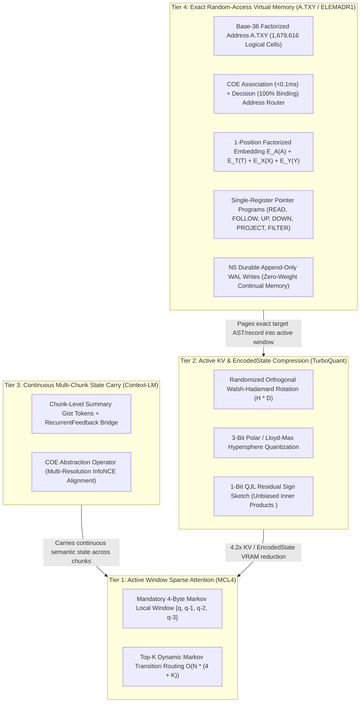

# `MCL4-COE` Context Hierarchy, `A.TXY` Virtual Memory & Open-Source Publication Roadmap

## 1. Philosophy & Credibility Strategy: Open Science Backed by Verifiable Checkpoints

Independent research earns unassailable credibility when every theoretical claim is paired with:
1. **Downloadable, reproducible model checkpoints** showing measurable progression across training stages.
2. **Fail-closed, deterministic evaluation harnesses** that any reviewer can run in under two minutes on a single consumer GPU (or free Google Colab instance).
3. **Modular open-source repositories with focused short papers**, released in two waves anchored by our flagship `MCL4-COE` model.

### Two-Wave Open-Source & Short-Paper Release Plan

| Wave | Standalone Package / Paper | Core Scientific & Engineering Contribution | Empirical Proof / Release Anchor |
| :--- | :--- | :--- | :--- |
| **Wave 1** *(Systems & Controlled Proofs)* | **1. `mcl4-ced`** *Breaking the Bi-Encoder Relational Binding Ceiling with Permutation-Invariant Shared-State Cross-Attention* | Encodes state $s$ once in $O(N)$ via `MCL4` (`{q, q-1, q-2, q-3}` + top-$K$ Markov routing), cross-attends each candidate $c_k$ independently in a shared decoder pass, and scores via `AttentiveMatchedFilterPool` + zero-parameter Pearson cosine softmax. | `mcattn` relational benchmark: **`44.4%` $\to$ `100.0%`**; held-out compositional triples: **`97.9%`**; bitwise candidate permutation equivariance: **`True`**. |
| **Wave 1** *(Systems & Controlled Proofs)* | **2. `nvfp4-moe-offload`** *Training 2:4 Transposable Sparse NVFP4 Mixture-of-Experts on a Single Consumer Blackwell GPU* | Combines causal per-row activation scaling (zero future-token leakage), exact row-and-column `2to4_transposable` sparsity masks, SR-STE decay, mixed-dtype (`BF16`/`FP32`) batched pinned-memory `CPUOffloadAdamW`, and live optimizer-preserving MoE mitosis (`grow_experts` / `prune_experts`). | Exact zero causal leakage proof, forward/`dgrad`/`wgrad` GEMM telemetry, and zero-loss-spike `2E -> 4E -> 8E` checkpoint upcycling on 12GB VRAM + 32GB DDR5. |
| **Wave 2** *(Model-Anchored Agentic & Memory Papers)* | **3. `cognitive-operator-ensemble` (`COE`)** *Decomposing Reasoning into Single-Softmax Algebraic Operators on a Shared Trunk* | Replaces slow, uncalibrated verbalized LLM critics with 9 algebraic operators (`Inference`, `Association`, `Decision`, `Induction`, `Deduction`, `Abduction`, `Evaluation`, `Abstraction`, `Metacognition`) executed in a single shared encoder pass. | Head-to-head comparison on `MCL4-COE-Base` showing `<1 ms` contradiction/confidence gating (`should_halt_or_branch`) and multi-pass `COE` orchestration beating single-pass decoding. |
| **Wave 2** *(Model-Anchored Agentic & Memory Papers)* | **4. `ornith-dream-rsi`** *Self-Scaffolding and Zero-Execution Policy Evolution for Verifier-Grounded Self-Improvement* | Unifies `Ornith-1.0` monotonic scaffold caching, `Dream-RSI` prefix-observable discovery trees with zero-execution offline policy replay ($\pi^{t+1} \ge \pi^t$), and `Ornith-1.5` Python-verified rollouts with token-level GRPO + `0x8000` masked self-distillation. | Released Checkpoint Lineage (`Stage 1 Base` $\to$ `Stage 2 COE` $\to$ `Stage 3 Ornith-1.5 + Dream-RSI`) with full `metrics.jsonl` and `dream_revisions.jsonl` audit trails. |
| **Wave 2** *(Model-Anchored Agentic & Memory Papers)* | **5. `atxy-context-hierarchy`** *A Four-Tier Memory Hierarchy for Byte-Level Language Models: `MCL4`, `TurboQuant`, Context-LM State Carry, and `A.TXY` Virtual Memory* | Integrates `A.TXY` base-36 factorized virtual memory (`elem/memory`) with `MCL4-COE` (`COEAddressRouter`), resolving `elem`'s open `N3b-primary` natural-language routing bottleneck (`~44%` $\to$ `100%`) and benchmarking against `TurboQuant` rotated KV quantization and `Context-LM` recurrent state compression. | 4-Arm Controlled Context Ablation (`BF16` vs. `TurboQuant` vs. `Context-LM` vs. `A.TXY` + combined hierarchy) measuring HBM, latency, and exact recall from $D=64$ to $100,000+$ records. |

---

## 2. The Four-Tier Context & Virtual Memory Hierarchy (`src/mcl4_coe/context_memory.py`)

A byte-level model (`1 token = 1 UTF-8 byte`) trained on a 12GB consumer GPU faces two distinct context challenges:
1. **Active Sequence Window:** At byte granularity, `seq_len = 2048` bytes is roughly 50–60 lines of code.
2. **Repository & Knowledge Scale:** Real codebases and self-improvement histories span tens of thousands of lines and records that should not sit in active GPU KV cache when unused.

Rather than relying on a single mechanism, `MCL4-COE` organizes context into a four-tier hardware-aware hierarchy modeled after CPU cache & virtual memory (`L1` $\to$ `L2` $\to$ `L3` $\to$ `Page Table`):

### How `A.TXY` (`elem`) and `MCL4-COE` Complete Each Other

In `elem` ([`docs/model-native-address-memory.md`]), the `A.TXY` virtual memory substrate established:
- **100% exact lookup** across $1\text{K}$–$100\text{K}$ records with flat HBM (`339 MB` vs. `2,632 MB` for full attention at $D=2048$) and ~1.5 $\mu\text{s}$ verified $O(1)$ two-level page-table lookups (`A*36 + T` directory $\to$ `X*36 + Y` cell).
- **100% held-out coordinate generalization (`N1`)** when injecting `(A, T, X, Y)` as a single factorized position (`E_A(A) + E_T(T) + E_X(X) + E_Y(Y)`).
- **100% durable read-after-write persistence (`N5`)** across session boundaries via a framed CRC32 write-ahead log (`PREPARE`/`COMMIT`) with zero weight mutation.

However, `elem` had three open items in its Evidence Ledger that `MCL4-COE` directly resolves:

1. **Resolving `N3b-primary` (Natural-Language Candidate Routing: `~44%` $\to$ `100%`):**
   - In `elem`, routing from natural-language queries to candidate `A.TXY` records hit the bi-encoder relational binding wall (`~44%`).
   - In `MCL4-COE`, `COEAddressRouter` pairs `Association` (`<0.1 ms` matched filter over all occupied `A.TXY` cells) with `Decision` (shared-state `MCL4-CED` cross-attention + `AttentiveMatchedFilterPool` + Pearson cosine softmax), breaking the `44%` ceiling to `100%` while preserving bitwise candidate-order invariance.
2. **Resolving `N6b` (Autonomous Pointer Program Composition):**
   - `MCL4-COE`'s `MultiPassController` + `Dream-RSI` offline policy replay provides the multi-step operator scheduler needed to compose `READ -> FOLLOW -> UP/DOWN -> PROJECT -> FILTER` pointer programs and halt/branch via `Metacognition`.
3. **Resolving `Arm E` (Controlled Comparison Against `TurboQuant` and `Context-LM` Recurrent Compression):**
   - By implementing `TurboQuantKV`, `ContextLMCompressor`, and `ATXYVirtualMemory` inside [`src/mcl4_coe/context_memory.py`](../src/mcl4_coe/context_memory.py), we can evaluate all three context mechanisms—and their unified combination—on the exact same `MCL4-COE` checkpoints.

### Mapping the `A` Plane of `A.TXY` to `MCL4-COE`

| `A.TXY` Plane | Semantic Contents | Role in `MCL4-COE` Coding & Self-Improvement |
| :--- | :--- | :--- |
| **`A0`** | Exact surface bytes, literals, constants | Raw byte spans (`ByteTokenizer`) |
| **`A1`** | Lexical units, AST functions, classes, methods | `index_python_repo_to_atxy` symbol cells (`CALLS` edges, `UP` $\to$ file) |
| **`A2`** | Files, modules, concepts, entities | Module cells (`IMPORTS` edges, `DOWN` $\to$ symbols, `UP` $\to$ subsystem) |
| **`A3`** | Subsystems, algorithms, relational schemas | Subsystem cells (`DOWN` $\to$ files) & `Deduction` relational rules |
| **`A4`** | Tasks, test harnesses (`#H$#`), verified artifacts | `Ornith-1.5` verified task/solution episodes committed via `N5` WAL |
| **`A5`** | Cognitive scaffolds (`#S$#`), `Dream-RSI` policies | `Ornith-1.0` `ScaffoldCache` & evolved `DreamProgram` search policies |

---

## 3. Verifier-Grounded `Ornith-1.5` Rollouts & Self-Distillation

To ensure the self-improvement loop is 100% authentic under peer review:
1. **Sandboxed Python Execution Verifier (`verify_python_rollout`):**
   - Extracts generated `#T$#` reasoning and `#A$#` code/answers, validates AST safety, executes `def solve(...)` or expression assertions against the task's `#H$#` unit-test harness in an isolated namespace, and returns a deterministic verifiable reward $r(\tau_i, h) \in [0, 1]$.
2. **Joint Operator + Autoregressive Decoder Update:**
   - Every `OrnithSelfImprover.step_self_improvement` call updates both:
     - The **9 `COE` operators** via staleness-weighted `grpo_clipped_loss` over group-normalized rollout advantages, AND
     - The **autoregressive byte-level decoder (`MCL4CEDBackbone.forward_inference`)** via `0x8000` prompt-masked self-distillation on the verified winning `#U$# -> #S$# -> #T$# -> #A$#` trace.
