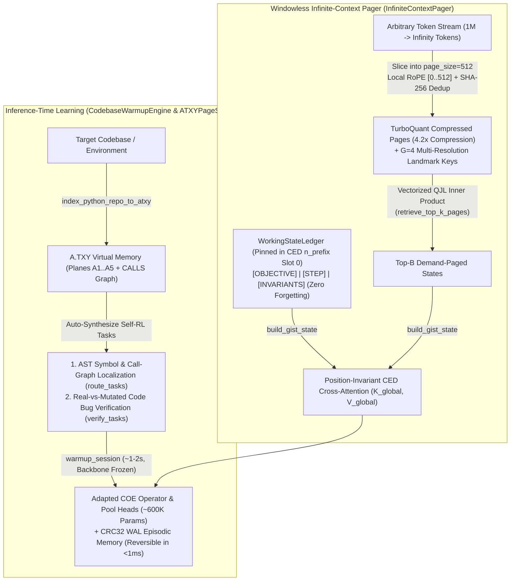

# 04. Four-Tier Context Hierarchy, Windowless Infinite-Context Inference & Inference-Time Learning (`src/mcl4_coe/context_memory.py`)

This document specifies the four-tier context hierarchy, windowless demand-paged context manager (`InfiniteContextPager` + `WorkingStateLedger`), and inference-time repository learning engine (`CodebaseWarmupEngine`) implemented in [`src/mcl4_coe/context_memory.py`](../src/mcl4_coe/context_memory.py).

---

## 1. Architectural Motivation & Subsystem Summary

Long-horizon reasoning, repository-scale code analysis, and continual self-improvement face three fundamental bottlenecks in standard autoregressive transformers:
1. **RoPE Positional Drift & Softmax Dilution:** Extending dense attention from 2K to 1M+ tokens pushes Rotary Position Embeddings (`RoPE`) out of distribution and dilutes the attention softmax denominator across thousands of irrelevant tokens.
2. **KV-Cache VRAM Saturation:** Uncompressed `BF16` key/value caches grow linearly with sequence length and quickly exhaust single-GPU VRAM.
3. **Static Weights on Unseen Environments:** Standard inference treats a new 100,000-line codebase as passive prompt text rather than adapting the model's routing and verification heads to the repository's AST invariants at test time.

`MCL4-COE` addresses all three through a four-tier memory hierarchy paired with demand-paged infinite context (`InfiniteContextPager`) and fast inference-time learning (`CodebaseWarmupEngine`):

| Tier / Subsystem | Module (`src/mcl4_coe/context_memory.py`) | Core Mechanism | Scaling & Memory Profile |
| :--- | :--- | :--- | :--- |
| **Tier 1 (`L1` Active Window)** | **`MarkovLocal4Router`** ([`markov_local4.py`](../src/mcl4_coe/markov_local4.py)) | Locks mandatory local anchor positions (`{q, q-1, ...}`) and routes bounded multi-hop Markov transitions across the token graph before executing exact QKV attention on $\mathcal{S}_q$. | $O(N \cdot K_{\mathrm{attend}})$ active attention; zero softmax dilution. |
| **Tier 2 (`L2` State Compression)** | **`TurboQuantKV` & `CompressedEncodedState`** | Orthonormal Fast Walsh-Hadamard Transform (`FWHT`, $O(D \log D)$ complexity) + 3-bit Lloyd-Max Gaussian centroids + 1-bit `QJL` residual sign sketch. | **`~4.2x` `EncodedState` & KV VRAM reduction** with unbiased rotated inner products (`turboquant_inner_product`). |
| **Tier 3 (`L3` Gist Carry)** | **`ContextLMCompressor`** | Condenses completed token chunks into compact gist vectors bridged across chunks via `RecurrentFeedback` and supervised by the `COE` `Abstraction` operator. | Continuous cross-chunk semantic carry at fixed window size. |
| **Tier 4 (`Page Table`)** | **`ATXYPageStore` & `COEAddressRouter`** | Base-36 factorized `A.TXY` virtual address space (`1,679,616` logical cells across Planes `A0..A5`), $O(1)$ two-level page directory, CRC32 `WAL`, and two-stage `Association` + `Decision` routing. | **100% exact lookup** across `1K–100K+` records (`~1.5 µs` page lookup) with flat HBM usage. |
| **Windowless Pager ($1\mathrm{M} \to \infty$)** | **`InfiniteContextPager` & `WorkingStateLedger`** | Encodes `page_size=512` pages with local RoPE `[0..page_size]`, pins `WorkingStateLedger` in `CED` `n_prefix` slot 0, and demand-pages only the `top-B` `TurboQuant` pages into position-invariant `CED` cross-attention. | **$1\mathrm{M} \to \infty$ effective context** with zero RoPE extrapolation drift and zero goal forgetting. |
| **Inference-Time Learning** | **`CodebaseWarmupEngine` & `CodebaseSessionState`** | Indexes a target repository AST into `A.TXY` + `TurboQuant`, synthesizes AST localization and bug-mutation verification tasks, and adapts the lightweight `COE` operator heads (`~600K` params) in `~1–2s` with `<1ms` rollback. | Fast test-time adaptation + incremental dirty-page refresh (`refresh_dirty_files`) without mutating frozen backbone weights. |

---

## 2. Windowless Infinite-Context Inference (`InfiniteContextPager` & `WorkingStateLedger`)

Implemented in [`src/mcl4_coe/context_memory.py`](../src/mcl4_coe/context_memory.py#L3052-L3470), `InfiniteContextPager` decouples effective context length from the backbone's physical sequence window:

1. **Zero-Forgetting Pinned `WorkingStateLedger` (`CED` `n_prefix` Slot 0):**
   * `WorkingStateLedger` stores the active high-level `objective`, `active_plan_step`, and verified key-value `pinned_facts` (`[OBJECTIVE] ... | [STEP] ... | [INVARIANTS] k=v`).
   * Its `TurboQuant`-compressed `EncodedState` is re-encoded only when modified (`_dirty = True`) and is permanently prepended to `gist_state` (`n_prefix` slot 0) on every forward pass so the model cannot lose track of its objective across millions of streamed tokens.
2. **Local-RoPE Page Ingestion (`ingest_tokens`):**
   * Incoming token streams are partitioned into `page_size` (`512`-token) chunks and deduplicated by SHA-256 digest.
   * Each page is encoded through `backbone.encode_state` using **local RoPE coordinates `[0 .. page_size - 1]`**, ensuring positional embeddings remain strictly in-distribution regardless of total ingested token count (`total_ingested_tokens`).
   * From each encoded page, `_compute_page_landmarks` extracts `G = 4` normalized multi-resolution landmark vectors, and both the full page (`CompressedEncodedState`) and landmarks (`CompressedKV`) are compressed `~4.2x` via `TurboQuant`.
3. **Vectorized `QJL` Retrieval & Position-Invariant `CED` Cross-Attention (`retrieve_top_k_pages` & `build_gist_state`):**
   * Given a query, `retrieve_top_k_pages` computes unbiased inner products (`turboquant_inner_product`) between the query's mean/tail vectors and all stored page landmarks directly in Walsh-Hadamard rotated space.
   * Only the `top-B` scoring pages (plus the most recent page) are decompressed and concatenated with the pinned `WorkingStateLedger` into a single position-invariant `EncodedState` fed into the upper `CED` decoder layers via `_cross_attend`.

---

## 3. Inference-Time Learning (`CodebaseWarmupEngine`, Dirty-Page Refresh & `A.TXY` WAL)

Rather than treating an unseen repository as static prompt text, `CodebaseWarmupEngine` ([`src/mcl4_coe/context_memory.py`](../src/mcl4_coe/context_memory.py#L1457-L2935)) adapts `MCL4-COE` directly to the target codebase at the start of—and throughout—an inference session:

### 3.1 AST Compilation & Self-Supervised Task Synthesis (`index_repository`)
When pointed at `repo_root`, `CodebaseWarmupEngine.index_repository`:
1. **Compiles the Repository AST into `ATXYPageStore`:** Populates Plane `A3` (subsystems), Plane `A2` (files/modules), and Plane `A1` (functions, classes, methods, signatures, docstrings, and `CALLS` / `UP` / `DOWN` edges).
2. **Compresses Module States via `TurboQuant`:** Encodes each module through the lower `CED` encoder stack, stores its 4-bit `CompressedEncodedState` (`file_turboquant_pages`), and extracts `Abstraction` latent priors (`file_latent_priors`).
3. **Synthesizes Two Verifiable AST Self-RL Task Families (`_build_codebase_tasks`):**
   * **Symbol & Call-Graph Localization (`route_tasks`):** Trains and evaluates routing from natural-language architecture/debugging queries (including call-graph hints) to the exact `A.TXY` symbol record against degree-balanced hard-negative symbols from the same module.
   * **Real-vs-Mutated Code Bug Discrimination (`verify_tasks`):** Splits each repository function into its shared setup context and focal executable invariant line (`_extract_focal_line_and_context`), generates realistic buggy mutations (`_mutate_focal_line`: operator flips `+` $\leftrightarrow$ `-`, boundary flips `<=` $\leftrightarrow$ `>`, axis swaps `dim=-1` $\leftrightarrow$ `dim=0`, guard inversions), and trains the `COE` operators to distinguish the authentic repository implementation from mutated variants.

### 3.2 Fast-Weight Session Warmup with Frozen Backbone (`warmup_session`)
* `warmup_session` freezes `coe.backbone` (`requires_grad = False`, preserving 100% of pretrained language generation fluency) and pre-caches the frozen backbone's `EncodedState` and `DecodedCandidates` across all synthesized repository tasks **once**.
* It then executes `24+` multi-operator gradient updates exclusively on the lightweight session-scoped `COE` operator and `AttentiveMatchedFilterPool` heads (`~600K` parameters) in **`~1–2 seconds`**.
* `CodebaseSessionState` retains a CPU snapshot of the base operator weights (`base_operator_state`), allowing instant `<1 ms` reset between sessions via `session.restore_base_weights(coe)`.

### 3.3 Incremental Dirty-Page Refresh (`refresh_dirty_files`) & Zero-Weight `WAL` Persistence
* When files are edited during an active coding session, `refresh_dirty_files` detects SHA-256 digest changes, re-parses only the modified files, appends `PREPARE`/`COMMIT` frames to the CRC32 Write-Ahead Log (`ATXYPageStore`), re-compresses the dirty `TurboQuant` pages, and runs a fast micro-warmup (`DirtyPageRefreshReport`).
* Verified `Ornith` task/harness episodes and evolved `Dream-RSI` search policies are simultaneously persisted into Planes `A4` and `A5` via the append-only `WAL`, providing continual episodic memory across sessions without mutating backbone weights.

---

## 4. `TurboQuantKV` & `A.TXY` Plane Allocation Reference

### 4.1 `TurboQuantKV` (`FWHT` + 3-Bit Lloyd-Max + 1-Bit `QJL`)
1. **Orthonormal Rademacher Walsh-Hadamard Rotation (`fast_walsh_hadamard`):**

$$
\tilde{x} = \frac{1}{\sqrt{D}} H (s \odot x), \qquad s \in \lbrace -1, +1 \rbrace^D
$$

   spreads channel outliers uniformly across coordinates in $O(D \log D)$ operations so normalized entries closely follow $\mathcal{N}(0, 1)$.
2. **3-Bit Lloyd-Max Centroid Quantization:** Quantizes rotated coordinates to the 8-level optimal Gaussian centroids (`{-2.1520, -1.3439, -0.7560, -0.2451, +0.2451, +0.7560, +1.3439, +2.1520}`).
3. **1-Bit `QJL` Residual Sign Sketch:** Sketches the quantization residual $r = \tilde{x} - \hat{x}_{3\mathrm{bit}}$ into 1-bit signs scaled by $\sqrt{\pi / 2} \lVert r \rVert_2 / \sqrt{D}$ for unbiased inner-product estimation.

### 4.2 `A.TXY` Semantic Plane Allocation (`A0` – `A5`)

| `A.TXY` Plane | Semantic Contents | Role in `MCL4-COE` Coding & Self-Improvement |
| :--- | :--- | :--- |
| **`A0`** | Surface bytes, string literals, constants | Raw byte/token spans |
| **`A1`** | Lexical units, AST functions, classes, methods | `index_python_repo_to_atxy` symbol cells (`CALLS` edges, `UP` $\to$ file) |
| **`A2`** | Files, modules, concepts, entities | Module cells (`IMPORTS` edges, `DOWN` $\to$ symbols, `UP` $\to$ subsystem) |
| **`A3`** | Subsystems, algorithms, relational schemas | Subsystem cells (`DOWN` $\to$ files) & `Deduction` relational rules |
| **`A4`** | Tasks, test harnesses (`#H$#`), verified artifacts | `Ornith` verified task/solution episodes committed via the CRC32 WAL |
| **`A5`** | Cognitive scaffolds (`#S$#`), `Dream-RSI` policies | `ScaffoldCache` entries & evolved `DreamProgram` search policies |
