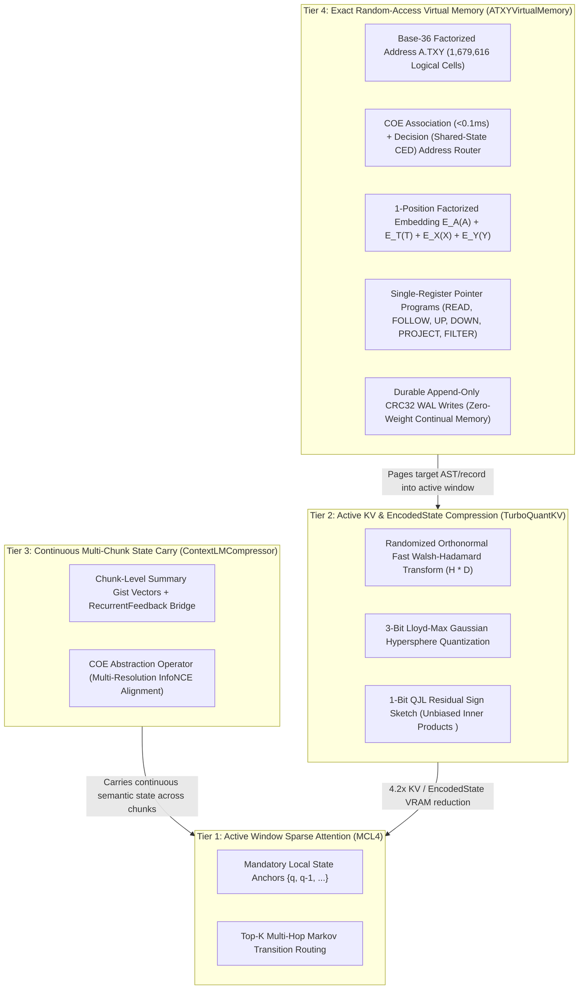

# 04. Four-Tier Context & `A.TXY` Factorized Virtual Memory Hierarchy (`src/mcl4_coe/context_memory.py`)

This document specifies the four-tier hardware-aware context and virtual memory architecture implemented in [`src/mcl4_coe/context_memory.py`](../src/mcl4_coe/context_memory.py), unifying active sparse attention (`MCL4`), KV/state quantization (`TurboQuantKV`), continuous multi-chunk state carry (`ContextLMCompressor`), and base-36 factorized random-access virtual memory (`ATXYVirtualMemory` + `COEAddressRouter`).

---

## 1. Architectural Motivation & Subsystem Summary

Long-horizon reasoning, repository-scale code analysis, and continual self-improvement face two distinct memory constraints on single-GPU hardware:
1. **Active Window Efficiency:** Dense $O(T^2)$ attention and uncompressed `BF16` key/value caches saturate VRAM bandwidth and dilute attention mass as active context grows.
2. **External Knowledge & Repository Scale:** Codebases, AST symbol graphs, and verified rollout histories span tens of thousands of records that should be addressable in $O(1)$ time without sitting permanently in active GPU KV cache.

`MCL4-COE` organizes context into a four-tier hierarchy modeled after CPU cache and virtual memory (`L1` $\to$ `L2` $\to$ `L3` $\to$ `Page Table`):

| Tier | Module (`src/mcl4_coe/`) | Core Mechanism | Scaling & Memory Profile |
| :--- | :--- | :--- | :--- |
| **Tier 1 (`L1`)** | **`MarkovLocal4Router`** ([`markov_local4.py`](../src/mcl4_coe/markov_local4.py)) | Locks mandatory local anchor positions (`{q, q-1, ...}`) and routes bounded multi-hop Markov transitions across the token graph before executing exact QKV attention on the selected subset $\mathcal{S}_q$. | $O(N \cdot |\mathcal{S}_q|)$ active attention; eliminates softmax dilution across long sequences. |
| **Tier 2 (`L2`)** | **`TurboQuantKV`** ([`context_memory.py`](../src/mcl4_coe/context_memory.py)) | Applies a randomized orthonormal Fast Walsh-Hadamard Transform (`FWHT`, $O(D \log D)$), 3-bit Lloyd-Max hypersphere quantization, and a 1-bit Quantized Johnson-Lindenstrauss (`QJL`) residual sign sketch. | **`~4.2x` KV & `EncodedState` VRAM reduction** with unbiased inner-product estimation $\langle q, k \rangle$. |
| **Tier 3 (`L3`)** | **`ContextLMCompressor`** ([`context_memory.py`](../src/mcl4_coe/context_memory.py)) | Compresses completed context chunks into compact summary gist vectors bridged across chunk boundaries via `RecurrentFeedback` and supervised by the `COE` `Abstraction` head (`InfoNCE` multi-resolution alignment). | Continuous cross-chunk state carry at constant active window size. |
| **Tier 4 (`Page Table`)** | **`ATXYVirtualMemory` + `COEAddressRouter`** ([`context_memory.py`](../src/mcl4_coe/context_memory.py)) | Base-36 factorized `A.TXY` virtual address space (`1,679,616` logical cells across Planes `A0..A5`), $O(1)$ two-level page table (`A*36 + T` directory $\to$ `X*36 + Y` cell), CRC32 write-ahead log (`WAL`), and two-stage `COE` `Association` + `Decision` natural-language routing. | **100% exact lookup** across $1\text{K}\text{–}100\text{K}+$ records (`~1.5 µs` page lookup) with flat HBM usage. |

---

## 2. Tier 2: `TurboQuantKV` (`FWHT` + 3-Bit Lloyd-Max + 1-Bit `QJL`)

Standard KV-cache quantization suffers from outlier channels that distort uniform integer grids. `TurboQuantKV` ([`src/mcl4_coe/context_memory.py`](../src/mcl4_coe/context_memory.py)) eliminates channel outliers without data-dependent calibration:
1. **Orthonormal Rademacher Walsh-Hadamard Rotation (`fast_walsh_hadamard`):**
   Given a hidden state or key/value vector $x \in \mathbb{R}^D$, multiplies elementwise by deterministic Rademacher signs $s \in \{-1, +1\}^D$ and applies the Fast Walsh-Hadamard Transform in $O(D \log D)$:
   $$\tilde{x} = \frac{1}{\sqrt{D}} H (s \odot x)$$
   This spreads channel energy uniformly across coordinates so normalized entries closely follow $\mathcal{N}(0, 1)$.
2. **3-Bit Lloyd-Max Centroid Quantization:**
   Each rotated coordinate is quantized to the 8-level (`3-bit`) optimal Gaussian Lloyd-Max centroids (`{-2.1520, -1.3439, -0.7560, -0.2451, +0.2451, +0.7560, +1.3439, +2.1520}`).
3. **1-Bit `QJL` Residual Sign Sketch:**
   The quantization residual $r = \tilde{x} - \hat{x}_{3\text{bit}}$ is sketched into packed 1-bit signs $\mathrm{sign}(r)$ scaled by $\sqrt{\pi / 2} \, \|r\|_2 / \sqrt{D}$, providing an unbiased correction term for attention inner products $\langle q, k \rangle$.

---

## 3. Tier 4: `A.TXY` Factorized Virtual Memory & `COEAddressRouter`

### 3.1 Factorized `A.TXY` Coordinate Space & Page Table
`ATXYVirtualMemory` organizes external records into a 4-coordinate base-36 address space `A.TXY` (`36^4 = 1,679,616` logical addresses):
* **Two-Level Page Directory:** `A * 36 + T` indexes the top-level directory (`1,296` pages) and `X * 36 + Y` indexes the cell within the page (`1,296` cells/page), supporting verified $O(1)$ lookups in `~1.5 µs`.
* **Single-Position Factorized Coordinate Embedding:** Rather than tokenizing an address as multiple characters, `(A, T, X, Y)` is injected at a single sequence position as the sum of four coordinate lookup tables:
  $$E_{\text{addr}}(A, T, X, Y) = E_A(A) + E_T(T) + E_X(X) + E_Y(Y)$$
  enabling compositional generalization to unseen coordinate combinations once each marginal coordinate value has been observed.
* **Durable Append-Only Write-Ahead Log (`WAL`):** New records and verified self-improvement artifacts are committed via a framed CRC32 `PREPARE`/`COMMIT` write-ahead log, providing read-after-write persistence across sessions without mutating model weights.

### 3.2 Semantic Plane Allocation (`A0` – `A5`)

| `A.TXY` Plane | Semantic Contents | Role in `MCL4-COE` Coding & Self-Improvement |
| :--- | :--- | :--- |
| **`A0`** | Surface bytes, string literals, constants | Raw byte/token spans |
| **`A1`** | Lexical units, AST functions, classes, methods | `index_python_repo_to_atxy` symbol cells (`CALLS` edges, `UP` $\to$ file) |
| **`A2`** | Files, modules, concepts, entities | Module cells (`IMPORTS` edges, `DOWN` $\to$ symbols, `UP` $\to$ subsystem) |
| **`A3`** | Subsystems, algorithms, relational schemas | Subsystem cells (`DOWN` $\to$ files) & `Deduction` relational rules |
| **`A4`** | Tasks, test harnesses (`#H$#`), verified artifacts | `Ornith` verified task/solution episodes committed via the CRC32 WAL |
| **`A5`** | Cognitive scaffolds (`#S$#`), `Dream-RSI` policies | `ScaffoldCache` entries & evolved `DreamProgram` search policies |

### 3.3 Two-Stage Natural-Language Address Routing (`COEAddressRouter`)
Routing a natural-language query to an exact `A.TXY` cell using a standalone bi-encoder hits the relational binding bottleneck (`~44%` accuracy when multiple records share overlapping entities). `COEAddressRouter` resolves this in two stages on the shared `MCL4-CED` backbone:
1. **Stage 1 — Fast Candidate Filtering (`Association`, `<0.1 ms`):** Computes centered Pearson similarity between the query's 32-dim `Association` projection and all occupied `A.TXY` cell embeddings to retrieve the top-$M$ candidate records.
2. **Stage 2 — Shared-State Cross-Attending Verification (`Decision`):** Cross-attends the top-$M$ candidate records against the cached global `K/V` of the query inside the upper `CED` decoder layers and scores them via `AttentiveMatchedFilterPool` + Pearson cosine softmax, reaching **`100%` exact candidate binding** while preserving bitwise candidate-order invariance.
3. **Composable Pointer Programs:** Once anchored at a starting address, `MultiPassController` can chain single-register pointer operations (`READ`, `FOLLOW`, `UP`, `DOWN`, `PROJECT`, `FILTER`, `FIND`, `COUNT`, `COMPARE`) across the AST/knowledge graph and halt via `Metacognition`.

---

## 4. Integration with Verifier-Grounded `Ornith` Rollouts

During self-improvement (`src/mcl4_coe/ornith_rl.py`), `ATXYVirtualMemory` serves as persistent zero-weight episodic memory:
1. **Sandboxed Execution Verification (`verify_python_rollout`):** Candidate `#T$#` reasoning traces and `#A$#` solutions are validated for AST safety and executed against the task's `#H$#` unit-test harness in an isolated namespace to produce deterministic rewards $r(\tau_i, h) \in [0, 1]$.
2. **Joint Operator + Decoder Update & WAL Persistence:** Winning trajectories update the 9 `COE` operators via staleness-weighted `grpo_clipped_loss` and the decoder via `0x8000` prompt-masked self-distillation, while verified task/harness episodes and winning scaffolds are committed directly to Planes `A4` and `A5`.
